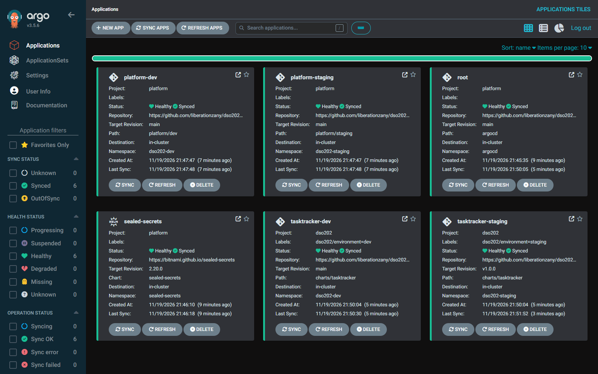
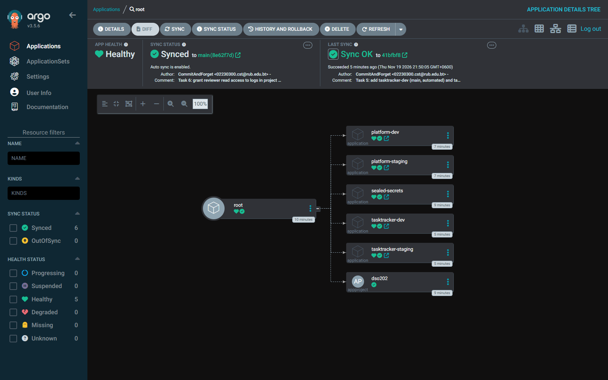
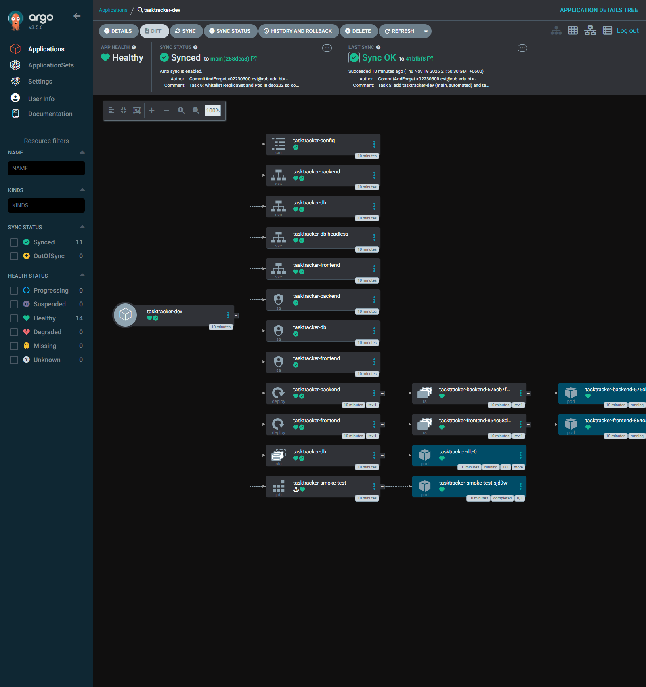
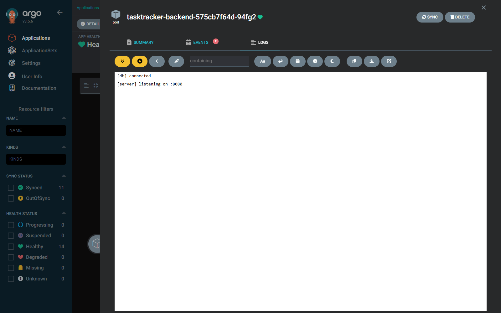

<!--
File       : docs/evidence.md
Assignment : DSO202 Assignment 4
Descriptor : Unit IV 4.1-4.4 (evidence for Tasks 1-9 and bonus Task 10)
Purpose    : Command output for every task, recorded as it was run (19-20
             November 2026). Credential values, tokens and key material never
             appear: secrets are shown as key names, lengths or hashes only.
-->
# Assignment 4 - Evidence

Repository: <https://github.com/liberationzany/dso202-gitops> -
cluster `dso202-gitops` (kind v0.32.0, Kubernetes v1.36.1), Argo CD v3.5.6,
Sealed Secrets chart 2.20.0 / controller 0.40.0.

Conventions: every block shows `$ command` followed by its real output.
Lines starting with `#` inside a block are notes added at the time. Where a
first attempt went wrong, it is kept and labelled rather than removed.
The `argocd` CLI is v3.5.6 from the `argocd-server` image, run in that Pod
(see README, *Deviations*).

## Task 1 - Repository, Chart Contract and Cluster

### Tool check (section 3.2) and chart checks
```text
$ docker version --format '{{.Server.Version}}'
29.4.0

$ kind version
kind v0.32.0 go1.26.5 windows/amd64

$ kubectl version --client
Client Version: v1.36.3
Kustomize Version: v5.8.1

$ helm version --short
v4.3.1+gc0d08d0

$ git --version
git version 2.54.0.windows.1

$ argocd version --client   # v3.5.6 CLI from the argocd-server image (Windows build download failed checksum, see README)
argocd: v3.5.6
  BuildDate: 2026-10-20T18:33:20Z
  GitCommit: c2b1e3017e2cec86b122172e861dcd026453ae44
  GitTreeState: clean
  GitTag: v3.5.6
  GoVersion: go1.26.10
  Compiler: gc
  Platform: linux/amd64

$ kubeseal --version
kubeseal version: 0.40.0

$ helm repo add sealed-secrets https://bitnami.github.io/sealed-secrets 2>&1 | tail -1; helm repo update sealed-secrets 2>&1 | grep -v WARN | tail -1
"sealed-secrets" already exists with the same configuration, skipping
Update Complete. ⎈Happy Helming!⎈

$ helm search repo sealed-secrets/sealed-secrets --versions | head -5
level=WARN msg="repo is corrupt or missing" repo=podinfo error="open C:\\Users\\zeroe\\AppData\\Local\\Temp\\helm\\repository\\podinfo-index.yaml: The system cannot find the file specified."
NAME                         	CHART VERSION	APP VERSION	DESCRIPTION                                  
sealed-secrets/sealed-secrets	2.22.0       	0.41.2     	Helm chart for the sealed-secrets controller.
sealed-secrets/sealed-secrets	2.21.0       	0.41.2     	Helm chart for the sealed-secrets controller.
sealed-secrets/sealed-secrets	2.20.0       	0.40.0     	Helm chart for the sealed-secrets controller.
sealed-secrets/sealed-secrets	2.19.3       	0.39.1     	Helm chart for the sealed-secrets controller.

$ helm lint charts/tasktracker -f environments/dev/values.yaml
==> Linting charts/tasktracker
[INFO] Chart.yaml: icon is recommended

1 chart(s) linted, 0 chart(s) failed

$ helm lint charts/tasktracker -f environments/staging/values.yaml
==> Linting charts/tasktracker
[INFO] Chart.yaml: icon is recommended

1 chart(s) linted, 0 chart(s) failed

$ helm template tasktracker charts/tasktracker -f environments/dev/values.yaml | grep '^kind:' | sort | uniq -c
      1 kind: ConfigMap
      2 kind: Deployment
      1 kind: Job
      4 kind: Service
      3 kind: ServiceAccount
      1 kind: StatefulSet
```

### Chart contract

| # | Requirement | Where it is satisfied |
|---|---|---|
| C1 | Image repository and tag are values per tier | `values.yaml`: `database.image`, `backend.image`, `frontend.image` (`repository`, `tag`); templates use `tasktracker.image` only |
| C2 | Per-tier configuration rendered from values | `templates/configmap.yaml` (`database.name`, `frontend.backendUrl`); `backend.service`, `frontend.service` |
| C3 | One more backend env var = values change only | `backend.extraEnv` map, rendered by the `range` in `templates/backend.yaml`; used in Task 7 (`APP_ENV`) |
| C4 | No Secret rendered; credentials from `existingSecret` | `values.yaml: existingSecret: tasktracker-credentials`; `secretKeyRef` in `db.yaml`, `backend.yaml`; no Secret template |
| C5 | Readiness probes on all three tiers | `db.yaml` (`pg_isready`), `backend.yaml` (`GET /api/status`), `frontend.yaml` (`GET /`) |
| C6 | Sync waves db 0, backend 1, frontend 2 | `argocd.argoproj.io/sync-wave` on the StatefulSet/Services in `db.yaml` ("0"), `backend.yaml` ("1"), `frontend.yaml` ("2") |
| C7 | `progressDeadlineSeconds: 120` | both Deployments (`backend.yaml`, `frontend.yaml`) |
| C8 | Requests and limits on every container | `*.resources` in `values.yaml`; fixed values in `smoke-test-job.yaml` |
| C9 | No Namespace, ResourceQuota, LimitRange, Role, RoleBinding | none in `templates/`; they live in `platform/<env>/` |
| C10 | Ingress template disabled by default | `templates/ingress.yaml` guarded by `ingress.enabled: false` |
| C11 | Frontend Service NodePort, port a value | `frontend.service.type: NodePort`, `nodePort`: 30080 (dev), 30081 (staging) |
| lint | `helm lint` clean, `helm template` succeeds for both | output above |

### Cluster
```text
$ kind get clusters
dso202
kind

$ docker ps -a --filter name=dso202-control-plane --format "{{.Names}} {{.Status}} {{.Ports}}"   # old cluster kept STOPPED (restart=no), not deleted - see README
dso202-control-plane Exited (137) 6 minutes ago 

$ kind create cluster --name dso202-gitops --config cluster/kind-cluster.yaml
Creating cluster "dso202-gitops" ...
 • Ensuring node image (kindest/node:v1.36.1) 🖼  ...
 ✓ Ensuring node image (kindest/node:v1.36.1) 🖼
 • Preparing nodes 📦 📦 📦   ...
 ✓ Preparing nodes 📦 📦 📦 
 • Writing configuration 📜  ...
 ✓ Writing configuration 📜
 • Starting control-plane 🕹️  ...
 ✓ Starting control-plane 🕹️
 • Installing CNI 🔌  ...
 ✓ Installing CNI 🔌
 • Installing StorageClass 💾  ...
 ✓ Installing StorageClass 💾
 • Joining worker nodes 🚜  ...
 ✓ Joining worker nodes 🚜
Set kubectl context to "kind-dso202-gitops"
You can now use your cluster with:

kubectl cluster-info --context kind-dso202-gitops

Have a nice day! 👋

$ kubectl config current-context
kind-dso202-gitops

$ kubectl get nodes
NAME            STATUS     ROLES           AGE   VERSION
control-plane   NotReady   control-plane   27s   v1.36.1
worker-node-1   NotReady   <none>          1s    v1.36.1
worker-node-2   NotReady   <none>          1s    v1.36.1

$ docker ps --filter name=dso202-gitops --format '{{.Names}} {{.Ports}}'
dso202-gitops-worker2 
dso202-gitops-control-plane 127.0.0.1:30080->30080/tcp, 127.0.0.1:30082->30082/tcp, 127.0.0.1:54646->6443/tcp
dso202-gitops-worker 

$ kubectl get nodes
NAME            STATUS   ROLES           AGE   VERSION
control-plane   Ready    control-plane   54s   v1.36.1
worker-node-1   Ready    <none>          28s   v1.36.1
worker-node-2   Ready    <none>          28s   v1.36.1
```

## Task 2 - Install Argo CD Declaratively

```text
$ kubectl kustomize bootstrap/argocd | grep -E '^kind: (Deployment|StatefulSet)' | sort | uniq -c
      6 kind: Deployment
      1 kind: StatefulSet

$ kubectl kustomize bootstrap/argocd | grep 'image:' | sort -u
        image: ghcr.io/dexidp/dex:v2.45.1
        image: public.ecr.aws/docker/library/redis:8.2.3-alpine
        image: quay.io/argoproj/argocd:v3.5.6

$ kubectl kustomize bootstrap/argocd | grep -E '^  namespace: ' | sort | uniq -c
     59   namespace: argocd

$ kubectl kustomize bootstrap/argocd | grep -E 'timeout.reconciliation|accounts.reviewer|policy.default|p, reviewer'
  accounts.reviewer: login
  timeout.reconciliation: 60s
  timeout.reconciliation.jitter: 10s
    p, reviewer, applications, get, dso202/*, allow
    p, reviewer, projects, get, dso202, allow
    # p, reviewer, logs, get, dso202/*, allow
  policy.default: ""
              key: timeout.reconciliation
              key: timeout.reconciliation
              key: timeout.reconciliation.jitter

$ kubectl kustomize bootstrap/argocd | python -c 'import sys,yaml; docs=[d for d in yaml.safe_load_all(sys.stdin) if d]; print(sorted({(d["metadata"]["name"], s.get("namespace")) for d in docs if d["kind"]=="ClusterRoleBinding" for s in d["subjects"]}))'   # ClusterRoleBinding subjects
[('argocd-application-controller', 'argocd'), ('argocd-applicationset-controller', 'argocd'), ('argocd-server', 'argocd')]

# Plain client-side apply first, to record the failure mode the brief describes
$ kubectl apply -k bootstrap/argocd 2>&1 | grep -iE "too long|error" | head -3
The CustomResourceDefinition "applicationsets.argoproj.io" is invalid: metadata.annotations: Too long: may not be more than 262144 bytes

$ kubectl apply -k bootstrap/argocd --server-side --force-conflicts | tail -5
networkpolicy.networking.k8s.io/argocd-dex-server-network-policy serverside-applied
networkpolicy.networking.k8s.io/argocd-notifications-controller-network-policy serverside-applied
networkpolicy.networking.k8s.io/argocd-redis-network-policy serverside-applied
networkpolicy.networking.k8s.io/argocd-repo-server-network-policy serverside-applied
networkpolicy.networking.k8s.io/argocd-server-network-policy serverside-applied

$ kubectl wait --for=condition=Available deployment --all -n argocd --timeout=600s
deployment.apps/argocd-applicationset-controller condition met
timed out waiting for the condition on deployments/argocd-dex-server
timed out waiting for the condition on deployments/argocd-notifications-controller
timed out waiting for the condition on deployments/argocd-redis
timed out waiting for the condition on deployments/argocd-repo-server
timed out waiting for the condition on deployments/argocd-server

$ kubectl rollout status statefulset/argocd-application-controller -n argocd --timeout=300s
partitioned roll out complete: 1 new pods have been updated...

$ kubectl get pods -n argocd
NAME                                                READY   STATUS            RESTARTS   AGE
argocd-application-controller-0                     1/1     Running           0          11m
argocd-applicationset-controller-58bb5c7479-294wd   1/1     Running           0          11m
argocd-dex-server-dd6b85d9c-ddfdq                   0/1     PodInitializing   0          11m
argocd-notifications-controller-6b85c65458-n9l4t    1/1     Running           0          11m
argocd-redis-869b85489d-g8j4m                       1/1     Running           0          11m
argocd-repo-server-5bf66565cd-5x2sw                 0/1     PodInitializing   0          11m
argocd-server-7474bb8f76-7dpmx                      1/1     Running           0          11m

$ kubectl get crd | grep argoproj.io
applications.argoproj.io      2026-11-19T15:26:47Z
applicationsets.argoproj.io   2026-11-19T15:26:52Z
appprojects.argoproj.io       2026-11-19T15:26:47Z

$ kubectl get configmap argocd-cm -n argocd -o yaml | grep -E 'timeout.reconciliation|accounts.reviewer|resource.customizations.health.argoproj.io_Application'
  accounts.reviewer: login
  resource.customizations.health.argoproj.io_Application: |
  timeout.reconciliation: 60s
  timeout.reconciliation.jitter: 10s
      (last-applied-configuration annotation from the failed client-side apply, 4022 characters, omitted)

$ kubectl get configmap argocd-rbac-cm -n argocd -o jsonpath='{.data}' ; echo
{"policy.csv":"# Task 6, step 2: view applications and the project, nothing else.\n# The object 'dso202/*' means \"every application in the dso202 project\".\np, reviewer, applications, get, dso202/*, allow\np, reviewer, projects, get, dso202, allow\n# Task 6, step 4 adds the line below. Until it is present, container logs\n# are hidden from this account: since Argo CD 3.0, logs are a separate RBAC\n# resource and are no longer implied by read access to the application.\n# p, reviewer, logs, get, dso202/*, allow\n","policy.default":""}

# The wait above timed out: image pulls over a slow link. argocd-repo-server
# and argocd-dex-server (both on worker-node-2) sat in PodInitializing for 16
# minutes with a pull that never finished, although the argocd image was
# already on that node. The upstream manifest uses imagePullPolicy: Always, so
# the kubelet re-contacts the registry even when the image is present. The two
# Pods were deleted (Argo CD's own components, not GitOps-managed objects) and
# their replacements started within a minute.

$ kubectl get deploy -n argocd -o custom-columns=NAME:.metadata.name,PULL_POLICY:.spec.template.spec.containers[0].imagePullPolicy
NAME                               PULL_POLICY
argocd-applicationset-controller   Always
argocd-dex-server                  Always
argocd-notifications-controller    Always
argocd-redis                       Always
argocd-repo-server                 Always
argocd-server                      Always

$ kubectl wait --for=condition=Available deployment --all -n argocd --timeout=600s
deployment.apps/argocd-applicationset-controller condition met
deployment.apps/argocd-dex-server condition met
deployment.apps/argocd-notifications-controller condition met
deployment.apps/argocd-redis condition met
deployment.apps/argocd-repo-server condition met
deployment.apps/argocd-server condition met

$ kubectl rollout status statefulset/argocd-application-controller -n argocd --timeout=300s
partitioned roll out complete: 1 new pods have been updated...

$ kubectl get pods -n argocd
NAME                                                READY   STATUS        RESTARTS   AGE
argocd-application-controller-0                     1/1     Running       0          17m
argocd-applicationset-controller-58bb5c7479-294wd   1/1     Running       0          17m
argocd-dex-server-dd6b85d9c-ddfdq                   1/1     Terminating   0          17m
argocd-dex-server-dd6b85d9c-zkbsb                   1/1     Running       0          25s
argocd-notifications-controller-6b85c65458-n9l4t    1/1     Running       0          17m
argocd-redis-869b85489d-g8j4m                       1/1     Running       0          17m
argocd-repo-server-5bf66565cd-4x2ht                 1/1     Running       0          26s
argocd-server-7474bb8f76-7dpmx                      1/1     Running       0          17m

$ kubectl get crd | grep argoproj.io
applications.argoproj.io      2026-11-19T15:26:47Z
applicationsets.argoproj.io   2026-11-19T15:26:52Z
appprojects.argoproj.io       2026-11-19T15:26:47Z

$ kubectl get configmap argocd-cm -n argocd -o yaml | grep -E 'timeout.reconciliation|accounts.reviewer|resource.customizations.health.argoproj.io_Application'
  accounts.reviewer: login
  resource.customizations.health.argoproj.io_Application: |
  timeout.reconciliation: 60s
  timeout.reconciliation.jitter: 10s
      (last-applied-configuration annotation from the failed client-side apply, 4022 characters, omitted)

# Sign-in. The argocd CLI used from here on is v3.5.6 from the argocd-server
# image, executed in that Pod (see README, "Deviations"): the Windows build of
# the same release was downloading at ~25 KB/s. Inside the Pod the API server
# is localhost:8080, the same address the port-forward gives on the host.
$ argocd admin initial-password -n argocd | sed -E 's/^[A-Za-z0-9-]{16}/<16-character password, not recorded>/'
<16-character password, not recorded>

 This password must be only used for first time login. We strongly recommend you update the password using `argocd account update-password`.

$ argocd login localhost:8080 --username admin --password "$P" --insecure
'admin:login' logged in successfully
Context 'localhost:8080' updated

$ argocd version
argocd: v3.5.6
  BuildDate: 2026-10-20T18:33:20Z
  GitCommit: c2b1e3017e2cec86b122172e861dcd026453ae44
  GitTreeState: clean
  GitTag: v3.5.6
  GoVersion: go1.26.10
  Compiler: gc
  Platform: linux/amd64
argocd-server: v3.5.6
  BuildDate: 2026-10-20T18:33:20Z
  GitCommit: c2b1e3017e2cec86b122172e861dcd026453ae44
  GitTreeState: clean
  GitTag: v3.5.6
  GoVersion: go1.26.10
  Compiler: gc
  Platform: linux/amd64
  Kustomize Version: v5.8.1 2026-02-09T16:15:27Z
  Helm Version: v4.2.1+gd591a19
  Kubectl Version: v0.36.1
  Jsonnet Version: v0.22.0

$ argocd account get-user-info
Logged In: true
Username: admin
Issuer: argocd
Groups:
```



## Task 3 - AppProjects and the Root Application

```text
$ helm template tasktracker charts/tasktracker -f environments/dev/values.yaml | grep '^kind:' | sort | uniq -c   # kinds rendered (Task 1 step 6); + Job from Task 5
      1 kind: ConfigMap
      2 kind: Deployment
      4 kind: Service
      3 kind: ServiceAccount
      1 kind: StatefulSet

$ kubectl apply -f bootstrap/root
appproject.argoproj.io/platform created
Warning: metadata.finalizers: "resources-finalizer.argocd.argoproj.io": prefer a domain-qualified finalizer name including a path (/) to avoid accidental conflicts with other finalizer writers
application.argoproj.io/root created

$ kubectl get appproject,application -n argocd
NAME                              AGE
appproject.argoproj.io/default    15m
appproject.argoproj.io/dso202     4s
appproject.argoproj.io/platform   11s

NAME                           SYNC STATUS   HEALTH STATUS
application.argoproj.io/root   Synced        Healthy

$ kubectl get application root -n argocd -o jsonpath='{range .status.resources[*]}{.kind}/{.name}  {.status}{"\n"}{end}'
AppProject/dso202  Synced

$ kubectl get appproject dso202 -n argocd -o jsonpath='{.metadata.labels}{"\n"}{.metadata.annotations.argocd\.argoproj\.io/tracking-id}{"\n"}'

root:argoproj.io/AppProject:argocd/dso202

$ kubectl get appproject dso202 -n argocd -o jsonpath='{range .spec.namespaceResourceWhitelist[*]}{.group}/{.kind} {end}{"\n"}cluster-scoped: {.spec.clusterResourceWhitelist}{"\n"}'
apps/Deployment apps/StatefulSet /Service /ConfigMap /ServiceAccount batch/Job 
cluster-scoped: []

# (captured after Task 4, so the platform Applications already appear)
$ argocd app get root
Name:               argocd/root
Project:            platform
Server:             https://kubernetes.default.svc
Namespace:          argocd
URL:                https://localhost:8080/applications/root
Source:
- Repo:             https://github.com/liberationzany/dso202-gitops.git
  Target:           main
  Path:             argocd
SyncWindow:         Sync Allowed
Sync Policy:        Automated (Prune)
Sync Status:        Synced to main (ac03779)
Health Status:      Healthy

GROUP        KIND         NAMESPACE  NAME              STATUS  HEALTH   HOOK  MESSAGE
argoproj.io  AppProject   argocd     dso202            Synced                 appproject.argoproj.io/dso202 unchanged
argoproj.io  Application  argocd     sealed-secrets    Synced  Healthy        application.argoproj.io/sealed-secrets unchanged
argoproj.io  Application  argocd     platform-staging  Synced  Healthy        application.argoproj.io/platform-staging created
argoproj.io  Application  argocd     platform-dev      Synced  Healthy        application.argoproj.io/platform-dev created

$ argocd proj get dso202
Name:                        dso202
Description:                 Task Tracker workloads for the dev and staging environments
Destinations:                https://kubernetes.default.svc,dso202-dev
                             https://kubernetes.default.svc,dso202-staging
Repositories:                https://github.com/liberationzany/dso202-gitops.git
Source Namespaces:           <none>
Scoped Repositories:         <none>
Allowed Cluster Resources:   <none>
Scoped Clusters:             <none>
Denied Namespaced Resources: <none>
Signature keys:              <none>
Orphaned Resources:          disabled

$ argocd proj get platform | head -12
Name:                        platform
Description:                 Platform layer - administrator level, applied by hand during bootstrap
Destinations:                https://kubernetes.default.svc,argocd
                             https://kubernetes.default.svc,sealed-secrets
                             https://kubernetes.default.svc,dso202-dev
                             https://kubernetes.default.svc,dso202-staging
Repositories:                https://github.com/liberationzany/dso202-gitops.git
                             https://bitnami.github.io/sealed-secrets
Source Namespaces:           <none>
Scoped Repositories:         <none>
Allowed Cluster Resources:   */*
Scoped Clusters:             <none>
```



## Task 4 - Platform Layer and Sealed Secrets

```text
$ date +%T; git log --oneline -1
21:46:05
7362de2 Task 4: install Sealed Secrets controller (chart 2.20.0) through the root Application

$ date +%T; kubectl get applications -n argocd
21:46:31
NAME             SYNC STATUS   HEALTH STATUS
root             Synced        Healthy
sealed-secrets   Synced        Healthy

$ kubectl get pods -n sealed-secrets
NAME                                        READY   STATUS    RESTARTS   AGE
sealed-secrets-controller-8b5ffdf69-ffgx6   1/1     Running   0          14s

$ kubectl get crd sealedsecrets.bitnami.com
NAME                        CREATED AT
sealedsecrets.bitnami.com   2026-11-19T15:46:17Z

# (the root was refreshed with 'kubectl annotate application root -n argocd argocd.argoproj.io/refresh=normal', the documented equivalent of 'argocd app get root --refresh'; the argocd CLI was still downloading)
$ kubectl get secret -n sealed-secrets -l sealedsecrets.bitnami.com/sealed-secrets-key -o yaml > C:/Users/zeroe/dso202-keys/sealing-key.backup.yaml; echo exit=$?
exit=0

$ icacls 'C:\Users\zeroe\dso202-keys\sealing-key.backup.yaml' /inheritance:r /grant:r "$USERNAME:(R,W)" | tail -1
Successfully processed 1 files; Failed processing 0 files

$ icacls 'C:\Users\zeroe\dso202-keys\sealing-key.backup.yaml'
C:\Users\zeroe\dso202-keys\sealing-key.backup.yaml LAPTOP-KL0T24AP\zeroe:(R,W)

Successfully processed 1 files; Failed processing 0 files

$ ls -l C:/Users/zeroe/dso202-keys/
total 8
-rw-r--r-- 1 zeroe 197609 7095 Nov 19 21:46 sealing-key.backup.yaml

$ grep -c 'tls.key' C:/Users/zeroe/dso202-keys/sealing-key.backup.yaml | sed 's/^/items containing a tls.key field: /'   # contents never shown
items containing a tls.key field: 1

$ kubectl create secret generic tasktracker-credentials --namespace dso202-dev --from-env-file=secrets-plain/dev.env --dry-run=client -o yaml | kubeseal --format yaml >> platform/dev/tasktracker-credentials.sealed.yaml; echo exit=$?
exit=0

$ kubectl create secret generic tasktracker-credentials --namespace dso202-staging --from-env-file=secrets-plain/staging.env --dry-run=client -o yaml | kubeseal --format yaml >> platform/staging/tasktracker-credentials.sealed.yaml; echo exit=$?
exit=0

$ sed -n '/^apiVersion/,$p' platform/dev/tasktracker-credentials.sealed.yaml | sed -E 's/(: Ag[A-Za-z0-9+\/=]{12})[A-Za-z0-9+\/=]+/\1...(abbreviated here; full in the file)/'
apiVersion: bitnami.com/v1alpha1
kind: SealedSecret
metadata:
  name: tasktracker-credentials
  namespace: dso202-dev
spec:
  encryptedData:
    DB_PASSWORD: AgC6FVtEWHCUyH...(abbreviated here; full in the file)
    DB_USER: AgAysTuqsf2jsD...(abbreviated here; full in the file)
    POSTGRES_PASSWORD: AgBmJ2jiKXxc2v...(abbreviated here; full in the file)
    POSTGRES_USER: AgBKY/fJqeyJTO...(abbreviated here; full in the file)
  template:
    metadata:
      name: tasktracker-credentials
      namespace: dso202-dev

$ date +%T; git log --oneline -2
21:47:39
ac03779 Task 4: add namespaces (Prune=false) and platform-dev/platform-staging Applications
dbdcb65 Task 4: add SealedSecrets for dev and staging credentials (strict scope, sealed per namespace)

$ date +%T; kubectl get applications -n argocd
21:47:50
NAME               SYNC STATUS   HEALTH STATUS
platform-dev       Synced        Healthy
platform-staging   Synced        Healthy
root               Synced        Healthy
sealed-secrets     Synced        Healthy

$ kubectl get namespaces | grep dso202
dso202-dev           Active   2s
dso202-staging       Active   2s

$ kubectl get sealedsecret -n dso202-dev; kubectl get sealedsecret -n dso202-staging
NAME                      STATUS   SYNCED   AGE
tasktracker-credentials            True     3s
NAME                      STATUS   SYNCED   AGE
tasktracker-credentials            True     3s

$ kubectl describe secret tasktracker-credentials -n dso202-dev
Name:         tasktracker-credentials
Namespace:    dso202-dev
Labels:       <none>
Annotations:  <none>

Type:  Opaque

Data
====
DB_PASSWORD:        24 bytes
DB_USER:            12 bytes
POSTGRES_PASSWORD:  24 bytes
POSTGRES_USER:      12 bytes

$ kubectl describe secret tasktracker-credentials -n dso202-staging | sed -n "/^Data/,\$p"
Data
====
DB_PASSWORD:        24 bytes
DB_USER:            16 bytes
POSTGRES_PASSWORD:  24 bytes
POSTGRES_USER:      16 bytes

$ kubectl get secret tasktracker-credentials -n dso202-dev -o jsonpath='{.metadata.ownerReferences[0].kind}/{.metadata.ownerReferences[0].name}'; echo '   <- created by the controller from the SealedSecret'
SealedSecret/tasktracker-credentials   <- created by the controller from the SealedSecret

$ kubectl get resourcequota,limitrange -n dso202-dev
NAME                         REQUEST                                                                                                                                               LIMIT                                   AGE
resourcequota/dso202-quota   count/configmaps: 1/10, count/secrets: 1/5, count/services: 0/6, persistentvolumeclaims: 0/2, pods: 0/10, requests.cpu: 0/1, requests.memory: 0/1Gi   limits.cpu: 0/2, limits.memory: 0/2Gi   4s

NAME                       CREATED AT
limitrange/dso202-limits   2026-11-19T15:47:48Z

$ kubectl get role,rolebinding,serviceaccount -n dso202-staging
NAME                                      CREATED AT
role.rbac.authorization.k8s.io/deployer   2026-11-19T15:47:48Z

NAME                                                                ROLE               AGE
rolebinding.rbac.authorization.k8s.io/deployer                      Role/deployer      4s
rolebinding.rbac.authorization.k8s.io/tasktracker-developers-view   ClusterRole/view   4s

NAME                      AGE
serviceaccount/default    4s
serviceaccount/deployer   4s

$ for each credential value V (values never printed):  git log -p --all -S"$V" | head   -> lines of output
  dev      DB_USER            -> 0 lines 
  dev      DB_PASSWORD        -> 0 lines 
  dev      POSTGRES_USER      -> 0 lines (same value as above)
  dev      POSTGRES_PASSWORD  -> 0 lines (same value as above)
  staging  DB_USER            -> 0 lines 
  staging  DB_PASSWORD        -> 0 lines 
  staging  POSTGRES_USER      -> 0 lines (same value as above)
  staging  POSTGRES_PASSWORD  -> 0 lines (same value as above)

$ git status --short --ignored
!! secrets-plain/
plaintext inputs deleted
```

## Task 5 - Deliver the Workloads to dev and staging

```text
$ git push origin main 2>&1 | tail -1
   ac03779..bf6325d  main -> main

$ git tag -a v1.0.0 -m "Baseline release: images 1.0"

$ git push origin v1.0.0 2>&1 | tail -1
 * [new tag]         v1.0.0 -> v1.0.0

$ git ls-remote --tags origin
18943a53eefdfa74910a924b4d8ec3afda1c2024	refs/tags/v1.0.0
bf6325d3e40535095c69cb35a8f95e0ccf6a536e	refs/tags/v1.0.0^{}

$ git ls-tree -r --name-only v1.0.0 | grep -E "smoke-test|environments/staging"
charts/tasktracker/templates/smoke-test-job.yaml
environments/staging/values.yaml

$ date +%T; git log --oneline -1
21:49:54
41bfbf8 Task 5: add tasktracker-dev (main, automated) and tasktracker-staging (v1.0.0, manual) Applications

$ kubectl get applications -n argocd
NAME                  SYNC STATUS   HEALTH STATUS
platform-dev          Synced        Healthy
platform-staging      Synced        Healthy
root                  Synced        Healthy
sealed-secrets        Synced        Healthy
tasktracker-dev       Synced        Healthy
tasktracker-staging   OutOfSync     Missing

$ kubectl get job -n dso202-dev
NAME                     STATUS     COMPLETIONS   DURATION   AGE
tasktracker-smoke-test   Complete   1/1           4s         36s

$ kubectl logs job/tasktracker-smoke-test -n dso202-dev
[{"id":1,"title":"Set up kind cluster","description":"Bring up the local cluster from Practical 1","status":"done","created_at":"2026-11-19T15:50:13.428Z"},{"id":2,"title":"Write namespace manifest","description":"One namespace for all assignment resources","status":"in_progress","created_at":"2026-11-19T15:50:13.428Z"},{"id":3,"title":"Wire ConfigMap and Secret","description":"DB_* and POSTGRES_* must carry matching values","status":"pending","created_at":"2026-11-19T15:50:13.428Z"}]
smoke test passed on attempt 1

$ argocd app get tasktracker-dev
Name:               argocd/tasktracker-dev
Project:            dso202
Server:             https://kubernetes.default.svc
Namespace:          dso202-dev
URL:                https://localhost:8080/applications/tasktracker-dev
Source:
- Repo:             https://github.com/liberationzany/dso202-gitops.git
  Target:           main
  Path:             charts/tasktracker
  Helm Values:      ../../environments/dev/values.yaml
SyncWindow:         Sync Allowed
Sync Policy:        Automated (Prune)
Sync Status:        Synced to main (41bfbf8)
Health Status:      Healthy

GROUP  KIND            NAMESPACE   NAME                     STATUS     HEALTH   HOOK      MESSAGE
       ServiceAccount  dso202-dev  tasktracker-frontend     Synced                        serviceaccount/tasktracker-frontend created
       ServiceAccount  dso202-dev  tasktracker-backend      Synced                        serviceaccount/tasktracker-backend created
       ServiceAccount  dso202-dev  tasktracker-db           Synced                        serviceaccount/tasktracker-db created
       ConfigMap       dso202-dev  tasktracker-config       Synced                        configmap/tasktracker-config created
       Service         dso202-dev  tasktracker-db-headless  Synced     Healthy            service/tasktracker-db-headless created
       Service         dso202-dev  tasktracker-db           Synced     Healthy            service/tasktracker-db created
apps   StatefulSet     dso202-dev  tasktracker-db           Synced     Healthy            statefulset rolling update complete 1 pods at revision tasktracker-db-67dfc859c5...
       Service         dso202-dev  tasktracker-backend      Synced     Healthy            service/tasktracker-backend created
apps   Deployment      dso202-dev  tasktracker-backend      Synced     Healthy            deployment.apps/tasktracker-backend created
       Service         dso202-dev  tasktracker-frontend     Synced     Healthy            service/tasktracker-frontend created
apps   Deployment      dso202-dev  tasktracker-frontend     Synced     Healthy            deployment.apps/tasktracker-frontend created
batch  Job             dso202-dev  tasktracker-smoke-test   Succeeded  Synced   PostSync  Reached expected number of succeeded pods

# Dev frontend and API from the host (kind maps 30080 and 30082)
$ curl -s http://localhost:30080/ | grep -o '<title>.*</title>\|<p class="subhead">.*</p>'
<title>Field Log — Task Tracker</title>
<p class="subhead">task tracker &mdash; unit i deployment demo</p>

$ curl -s http://localhost:30080/config.js | grep BACKEND_URL
  BACKEND_URL: "http://localhost:30082"

$ curl -s http://localhost:30082/api/status; echo
{"status":"ok","db":"connected"}

# CRUD cycle (as in Assignment 1)
$ curl -s -X POST -H 'Content-Type: application/json' -d '{"title":"Delivered by Argo CD"}' http://localhost:30082/api/tasks; echo
{"id":4,"title":"Delivered by Argo CD","description":null,"status":"pending","created_at":"2026-11-19T15:51:02.709Z"}

$ curl -s http://localhost:30082/api/tasks/4; echo
{"id":4,"title":"Delivered by Argo CD","description":null,"status":"pending","created_at":"2026-11-19T15:51:02.709Z"}

$ curl -s -X PUT -H 'Content-Type: application/json' -d '{"status":"done"}' http://localhost:30082/api/tasks/4; echo
{"id":4,"title":"Delivered by Argo CD","description":null,"status":"done","created_at":"2026-11-19T15:51:02.709Z"}

$ curl -s -o /dev/null -w 'DELETE -> %{http_code}\n' -X DELETE http://localhost:30082/api/tasks/4; curl -s -o /dev/null -w 'GET after delete -> %{http_code}\n' http://localhost:30082/api/tasks/4
DELETE -> 204
GET after delete -> 404

# Root BEFORE the first staging sync
$ argocd app get root | sed -n "/^Sync Status/,\$p"
Sync Status:        Synced to main (41bfbf8)
Health Status:      Healthy

GROUP        KIND         NAMESPACE  NAME                 STATUS  HEALTH   HOOK  MESSAGE
argoproj.io  Application  argocd     tasktracker-staging  Synced  Missing        application.argoproj.io/tasktracker-staging unchanged
argoproj.io  Application  argocd     tasktracker-dev      Synced  Healthy        application.argoproj.io/tasktracker-dev unchanged
argoproj.io  AppProject   argocd     dso202               Synced                 
argoproj.io  Application  argocd     platform-dev         Synced  Healthy        
argoproj.io  Application  argocd     platform-staging     Synced  Healthy        
argoproj.io  Application  argocd     sealed-secrets       Synced  Healthy        

$ kubectl get application tasktracker-staging -n argocd -o jsonpath='staging: sync={.status.sync.status} health={.status.health.status}{"\n"}'
staging: sync=OutOfSync health=Missing

$ argocd app get tasktracker-staging | sed -n "/^Sync Policy/,\$p"
Sync Policy:        Manual
Sync Status:        OutOfSync from v1.0.0 (bf6325d)
Health Status:      Missing

GROUP  KIND            NAMESPACE       NAME                     STATUS     HEALTH   HOOK  MESSAGE
       ConfigMap       dso202-staging  tasktracker-config       OutOfSync  Missing        
       Service         dso202-staging  tasktracker-backend      OutOfSync  Missing        
       Service         dso202-staging  tasktracker-db           OutOfSync  Missing        
       Service         dso202-staging  tasktracker-db-headless  OutOfSync  Missing        
       Service         dso202-staging  tasktracker-frontend     OutOfSync  Missing        
       ServiceAccount  dso202-staging  tasktracker-backend      OutOfSync  Missing        
       ServiceAccount  dso202-staging  tasktracker-db           OutOfSync  Missing        
       ServiceAccount  dso202-staging  tasktracker-frontend     OutOfSync  Missing        
apps   Deployment      dso202-staging  tasktracker-backend      OutOfSync  Missing        
apps   Deployment      dso202-staging  tasktracker-frontend     OutOfSync  Missing        
apps   StatefulSet     dso202-staging  tasktracker-db           OutOfSync  Missing        

$ kubectl get all -n dso202-staging 2>&1 | head -3
No resources found in dso202-staging namespace.

$ argocd app sync tasktracker-staging --timeout 300 | sed -n "/^Sync Status/,/^Duration/p"
Sync Status:        Synced to v1.0.0 (bf6325d)
Health Status:      Healthy

Operation:          Sync
Sync Revision:      bf6325d3e40535095c69cb35a8f95e0ccf6a536e
Phase:              Succeeded
Start:              2026-11-19 15:51:29 +0000 UTC
Finished:           2026-11-19 15:51:52 +0000 UTC
Duration:           23s

$ argocd app get tasktracker-staging | sed -n "/^Sync Policy/,\$p"
Sync Policy:        Manual
Sync Status:        Synced to v1.0.0 (bf6325d)
Health Status:      Healthy

GROUP  KIND            NAMESPACE       NAME                     STATUS     HEALTH   HOOK      MESSAGE
       ServiceAccount  dso202-staging  tasktracker-db           Synced                        serviceaccount/tasktracker-db created
       ServiceAccount  dso202-staging  tasktracker-frontend     Synced                        serviceaccount/tasktracker-frontend created
       ServiceAccount  dso202-staging  tasktracker-backend      Synced                        serviceaccount/tasktracker-backend created
       ConfigMap       dso202-staging  tasktracker-config       Synced                        configmap/tasktracker-config created
       Service         dso202-staging  tasktracker-db-headless  Synced     Healthy            service/tasktracker-db-headless created
       Service         dso202-staging  tasktracker-db           Synced     Healthy            service/tasktracker-db created
apps   StatefulSet     dso202-staging  tasktracker-db           Synced     Healthy            statefulset rolling update complete 1 pods at revision tasktracker-db-67dfc859c5...
       Service         dso202-staging  tasktracker-backend      Synced     Healthy            service/tasktracker-backend created
apps   Deployment      dso202-staging  tasktracker-backend      Synced     Healthy            deployment.apps/tasktracker-backend created
       Service         dso202-staging  tasktracker-frontend     Synced     Healthy            service/tasktracker-frontend created
apps   Deployment      dso202-staging  tasktracker-frontend     Synced     Healthy            deployment.apps/tasktracker-frontend created
batch  Job             dso202-staging  tasktracker-smoke-test   Succeeded  Synced   PostSync  Reached expected number of succeeded pods

# Root AFTER the first staging sync
$ kubectl get applications -n argocd
NAME                  SYNC STATUS   HEALTH STATUS
platform-dev          Synced        Healthy
platform-staging      Synced        Healthy
root                  Synced        Healthy
sealed-secrets        Synced        Healthy
tasktracker-dev       Synced        Healthy
tasktracker-staging   Synced        Healthy

$ kubectl get svc -n dso202-staging
NAME                      TYPE        CLUSTER-IP     EXTERNAL-IP   PORT(S)          AGE
tasktracker-backend       ClusterIP   10.96.74.140   <none>        8080/TCP         16s
tasktracker-db            ClusterIP   10.96.72.214   <none>        5432/TCP         25s
tasktracker-db-headless   ClusterIP   None           <none>        5432/TCP         25s
tasktracker-frontend      NodePort    10.96.74.245   <none>        8080:30081/TCP   10s

$ kubectl logs job/tasktracker-smoke-test -n dso202-staging | tail -1
smoke test passed on attempt 1

# Staging through port-forwards: frontend 8081 -> svc/tasktracker-frontend:8080, backend 8082 -> svc/tasktracker-backend:8080
$ curl -s http://localhost:8081/ | grep -o '<p class="subhead">.*</p>'; curl -s http://localhost:8081/config.js | grep BACKEND_URL
<p class="subhead">task tracker &mdash; unit i deployment demo</p>
  BACKEND_URL: "http://localhost:8082"

$ curl -s http://localhost:8082/api/status; echo; curl -s -X POST -H 'Content-Type: application/json' -d '{"title":"staging works"}' http://localhost:8082/api/tasks; echo
{"status":"ok","db":"connected"}
{"id":4,"title":"staging works","description":null,"status":"pending","created_at":"2026-11-19T15:52:10.882Z"}
```

### Pod creation order in dev (`kubectl get pods -n dso202-dev -w`, timestamps added)

```text
21:50:06  NAME               READY   STATUS    RESTARTS   AGE
21:50:06  tasktracker-db-0   0/1     Pending   0          0s
21:50:06  tasktracker-db-0   0/1     Pending   0          0s
21:50:10  tasktracker-db-0   0/1     Pending   0          4s
21:50:10  tasktracker-db-0   0/1     ContainerCreating   0          4s
21:50:10  tasktracker-db-0   0/1     ContainerCreating   0          4s
21:50:10  tasktracker-db-0   0/1     Running             0          4s
21:50:16  tasktracker-db-0   1/1     Running             0          10s
21:50:16  tasktracker-db-0   1/1     Running             0          10s
21:50:16  tasktracker-backend-575cb7f64d-94fg2   0/1     Pending             0          0s
21:50:16  tasktracker-backend-575cb7f64d-94fg2   0/1     Pending             0          0s
21:50:16  tasktracker-backend-575cb7f64d-94fg2   0/1     ContainerCreating   0          0s
21:50:17  tasktracker-backend-575cb7f64d-94fg2   0/1     ContainerCreating   0          1s
21:50:17  tasktracker-backend-575cb7f64d-94fg2   0/1     Running             0          1s
21:50:23  tasktracker-backend-575cb7f64d-94fg2   1/1     Running             0          7s
21:50:23  tasktracker-backend-575cb7f64d-94fg2   1/1     Running             0          7s
21:50:23  tasktracker-frontend-854c58d74d-hhsnv   0/1     Pending             0          0s
21:50:23  tasktracker-frontend-854c58d74d-hhsnv   0/1     Pending             0          0s
21:50:23  tasktracker-frontend-854c58d74d-hhsnv   0/1     ContainerCreating   0          0s
21:50:24  tasktracker-frontend-854c58d74d-hhsnv   0/1     ContainerCreating   0          1s
21:50:24  tasktracker-frontend-854c58d74d-hhsnv   0/1     Running             0          1s
21:50:25  tasktracker-frontend-854c58d74d-hhsnv   1/1     Running             0          2s
21:50:25  tasktracker-smoke-test-sjd9w            0/1     Pending             0          0s
21:50:25  tasktracker-smoke-test-sjd9w            0/1     Pending             0          0s
21:50:25  tasktracker-smoke-test-sjd9w            0/1     ContainerCreating   0          0s
21:50:26  tasktracker-frontend-854c58d74d-hhsnv   1/1     Running             0          3s
21:50:26  tasktracker-smoke-test-sjd9w            0/1     ContainerCreating   0          1s
21:50:27  tasktracker-smoke-test-sjd9w            1/1     Running             0          2s
21:50:28  tasktracker-smoke-test-sjd9w            0/1     Completed           0          3s
21:50:29  tasktracker-smoke-test-sjd9w            0/1     Completed           0          4s
21:50:29  tasktracker-smoke-test-sjd9w            0/1     Completed           0          4s
21:50:29  tasktracker-smoke-test-sjd9w            0/1     Completed           0          5s
```

### Applications during the first sync (`kubectl get applications -n argocd -w`)

```text
21:49:49  NAME               SYNC STATUS   HEALTH STATUS
21:49:49  platform-dev       Synced        Healthy
21:49:49  platform-staging   Synced        Healthy
21:49:49  root               Synced        Healthy
21:49:49  sealed-secrets     Synced        Healthy
21:49:55  root               Synced        Healthy
21:49:57  root               Synced        Healthy
21:49:58  root               Synced        Healthy
21:49:58  root               OutOfSync     Healthy
21:50:00  root               OutOfSync     Healthy
21:50:02  root               OutOfSync     Healthy
21:50:04  root               OutOfSync     Healthy
21:50:04  tasktracker-staging                 
21:50:04  tasktracker-dev                     
21:50:04  root                  OutOfSync     Healthy
21:50:04  root                  OutOfSync     Healthy
21:50:04  root                  OutOfSync     Healthy
21:50:04  root                  OutOfSync     Healthy
21:50:05  root                  OutOfSync     Healthy
21:50:05  root                  Synced        Progressing
21:50:05  root                  Synced        Progressing
21:50:05  root                  Synced        Progressing
21:50:05  tasktracker-staging   OutOfSync     Missing
21:50:05  tasktracker-dev                     
21:50:05  tasktracker-dev                     
21:50:05  tasktracker-dev       OutOfSync     Missing
21:50:05  root                  Synced        Healthy
21:50:06  tasktracker-dev       OutOfSync     Healthy
21:50:06  tasktracker-dev       OutOfSync     Progressing
21:50:06  root                  Synced        Progressing
21:50:08  tasktracker-dev       OutOfSync     Progressing
21:50:08  tasktracker-dev       OutOfSync     Progressing
21:50:16  tasktracker-dev       OutOfSync     Healthy
21:50:16  root                  Synced        Healthy
21:50:16  tasktracker-dev       OutOfSync     Healthy
21:50:16  tasktracker-dev       OutOfSync     Progressing
21:50:17  root                  Synced        Progressing
21:50:18  tasktracker-dev       OutOfSync     Progressing
21:50:18  tasktracker-dev       OutOfSync     Progressing
21:50:23  tasktracker-dev       OutOfSync     Healthy
21:50:23  root                  Synced        Healthy
21:50:23  tasktracker-dev       Synced        Progressing
21:50:23  root                  Synced        Progressing
21:50:25  tasktracker-dev       Synced        Healthy
21:50:25  root                  Synced        Healthy
21:50:25  tasktracker-dev       Synced        Healthy
21:50:25  tasktracker-dev       Synced        Healthy
21:50:25  tasktracker-dev       Synced        Healthy
21:50:30  tasktracker-dev       Synced        Healthy
21:50:30  tasktracker-dev       Synced        Healthy
21:50:30  tasktracker-dev       Synced        Healthy
21:51:29  tasktracker-staging   OutOfSync     Missing
21:51:29  tasktracker-staging   OutOfSync     Missing
21:51:29  tasktracker-staging   OutOfSync     Missing
21:51:30  tasktracker-staging   OutOfSync     Healthy
21:51:30  tasktracker-staging   OutOfSync     Healthy
21:51:30  root                  Synced        Healthy
21:51:30  tasktracker-staging   OutOfSync     Progressing
21:51:30  root                  Synced        Progressing
21:51:32  tasktracker-staging   OutOfSync     Progressing
21:51:32  tasktracker-staging   OutOfSync     Progressing
21:51:37  sealed-secrets        Synced        Healthy
21:51:39  tasktracker-staging   OutOfSync     Healthy
21:51:39  tasktracker-staging   OutOfSync     Healthy
21:51:39  root                  Synced        Healthy
21:51:39  tasktracker-staging   OutOfSync     Progressing
21:51:39  root                  Synced        Progressing
21:51:41  tasktracker-dev       Synced        Healthy
21:51:41  tasktracker-staging   OutOfSync     Progressing
21:51:41  tasktracker-staging   OutOfSync     Progressing
21:51:44  platform-dev          Synced        Healthy
21:51:44  platform-staging      Synced        Healthy
21:51:45  tasktracker-staging   OutOfSync     Healthy
21:51:45  root                  Synced        Healthy
21:51:45  tasktracker-staging   Synced        Progressing
21:51:45  root                  Synced        Progressing
21:51:46  tasktracker-staging   Synced        Healthy
21:51:46  root                  Synced        Healthy
21:51:47  tasktracker-staging   Synced        Healthy
21:51:47  tasktracker-staging   Synced        Healthy
21:51:47  tasktracker-staging   Synced        Healthy
21:51:52  tasktracker-staging   Synced        Healthy
21:51:52  tasktracker-staging   Synced        Healthy
21:51:53  tasktracker-staging   Synced        Healthy
21:51:53  tasktracker-staging   Synced        Healthy
21:51:54  tasktracker-staging   Synced        Healthy
21:52:39  sealed-secrets        Synced        Healthy
21:52:41  root                  Synced        Healthy
21:53:40  tasktracker-staging   Synced        Healthy
21:53:41  platform-staging      Synced        Healthy
21:53:42  root                  Synced        Healthy
21:53:42  sealed-secrets        Synced        Healthy
21:53:43  platform-dev          Synced        Healthy
21:53:44  tasktracker-dev       Synced        Healthy
21:55:36  tasktracker-dev       Synced        Healthy
21:55:36  sealed-secrets        Synced        Healthy
21:55:42  root                  Synced        Healthy
21:55:42  tasktracker-staging   Synced        Healthy
21:55:43  platform-dev          Synced        Healthy
21:55:43  platform-staging      Synced        Healthy
21:56:41  sealed-secrets        Synced        Healthy
21:56:44  tasktracker-dev       Synced        Healthy
21:57:35  tasktracker-staging   Synced        Healthy
21:57:36  root                  Synced        Healthy
21:57:42  platform-dev          Synced        Healthy
21:57:43  platform-staging      Synced        Healthy
21:58:34  sealed-secrets        Synced        Healthy
21:58:38  tasktracker-staging   Synced        Healthy
21:58:40  root                  Synced        Healthy
21:58:42  tasktracker-dev       Synced        Healthy
21:58:55  root                  Synced        Healthy
21:58:57  root                  Synced        Healthy
21:58:57  root                  OutOfSync     Healthy
21:58:57  root                  OutOfSync     Healthy
21:58:58  root                  Synced        Healthy
21:59:00  root                  Synced        Healthy
21:59:02  root                  Synced        Healthy
21:59:04  root                  Synced        Healthy
21:59:04  root                  Synced        Healthy
21:59:04  root                  Synced        Healthy
21:59:04  root                  Synced        Healthy
21:59:18  tasktracker-dev       Synced        Healthy
21:59:18  tasktracker-dev       Synced        Healthy
21:59:34  platform-staging      Synced        Healthy
21:59:39  sealed-secrets        Synced        Healthy
21:59:41  platform-dev          Synced        Healthy
```



## Task 6 - Access Control for Argo CD Users

```text
$ argocd account list
NAME      ENABLED  CAPABILITIES
admin     true     login
reviewer  true     login

$ argocd account update-password --account reviewer --current-password "$P" --new-password "$RP"   # values not recorded
Password updated

$ argocd login localhost:8080 --username reviewer --password "$RP" --insecure --name reviewer
'reviewer:login' logged in successfully
Context 'reviewer' updated

$ argocd context
CURRENT  NAME            SERVER
         localhost:8080  localhost:8080
*        reviewer        localhost:8080

$ argocd --argocd-context reviewer app list
NAME                        CLUSTER                         NAMESPACE       PROJECT  STATUS  HEALTH   SYNCPOLICY  CONDITIONS  REPO                                                 PATH                TARGET
argocd/tasktracker-dev      https://kubernetes.default.svc  dso202-dev      dso202   Synced  Healthy  Auto-Prune  <none>      https://github.com/liberationzany/dso202-gitops.git  charts/tasktracker  main
argocd/tasktracker-staging  https://kubernetes.default.svc  dso202-staging  dso202   Synced  Healthy  Manual      <none>      https://github.com/liberationzany/dso202-gitops.git  charts/tasktracker  v1.0.0

$ argocd --argocd-context reviewer account can-i get applications 'dso202/tasktracker-dev'
yes

$ argocd --argocd-context reviewer account can-i sync applications 'dso202/tasktracker-dev'
no

$ argocd --argocd-context reviewer account can-i get logs 'dso202/tasktracker-dev'
no

$ argocd --argocd-context reviewer proj get platform
{"level":"fatal","msg":"rpc error: code = PermissionDenied desc = permission denied: projects, get, platform, sub: reviewer, iat: 2026-11-19T15:52:25Z","time":"2026-11-19T15:52:27Z"}
command terminated with exit code 20

$ argocd --argocd-context reviewer app logs tasktracker-dev --kind Deployment --name tasktracker-backend --tail 2 2>&1 | tail -2
{"level":"fatal","msg":"stream read failed: rpc error: code = PermissionDenied desc = permission denied: logs, get, dso202/tasktracker-dev, sub: reviewer, iat: 2026-11-19T15:52:25Z","time":"2026-11-19T15:52:28Z"}
command terminated with exit code 1

$ argocd --argocd-context reviewer app sync tasktracker-dev 2>&1 | grep -o 'permission denied[^"]*' | head -1
permission denied: applications, sync, dso202/tasktracker-dev, sub: reviewer, iat: 2026-11-19T15:52:25Z

$ git diff bootstrap/argocd/argocd-rbac-cm-patch.yaml | grep "^[-+] "
-    # p, reviewer, logs, get, dso202/*, allow
+    p, reviewer, logs, get, dso202/*, allow

$ git log --oneline -1
8e62f7d Task 6: grant reviewer read access to logs in project dso202

$ kubectl apply -k bootstrap/argocd --server-side --force-conflicts | grep 'configmap/argocd-rbac-cm'
configmap/argocd-rbac-cm serverside-applied
(server-side apply reports every object of the install as 'serverside-applied', changed or not; only argocd-rbac-cm changed)

$ argocd --argocd-context reviewer account can-i get logs 'dso202/tasktracker-dev'
yes

$ argocd --argocd-context reviewer account can-i sync applications 'dso202/tasktracker-dev'   # still no: only one rule was added
no

$ argocd --argocd-context reviewer app logs tasktracker-dev --group apps --kind Deployment --name tasktracker-backend --tail 3

(No lines and exit code 0 - the same for admin, with --follow, with a container
name and with a Pod name - although 'kubectl logs' shows the backend's two
lines. Authorisation had changed: before the commit this request failed with
'PermissionDenied: logs, get, dso202/tasktracker-dev'; after it the API server
completes the call with grpc.code OK (below). The empty result was traced
further down to the resource tree; the fix and the working output follow.)

$ argocd login localhost:8080 --username admin --password "$P" --insecure   # step 5: back to the administrator session
'admin:login' logged in successfully
Context 'localhost:8080' updated

$ argocd context; argocd account get-user-info | head -2
CURRENT  NAME            SERVER
*        localhost:8080  localhost:8080
         reviewer        localhost:8080
Logged In: true
Username: admin

$ kubectl logs -n argocd deploy/argocd-server --since=10m | grep -E 'PodLogs' | grep -E 'PermissionDenied|"grpc.code":"OK"' | python -c 'import sys,json; [print(json.loads(l).get("time"), json.loads(l).get("grpc.code"), (json.loads(l).get("grpc.error") or "")[:90]) for l in sys.stdin]' | head -6
2026-11-19T15:52:28Z PermissionDenied rpc error: code = PermissionDenied desc = permission denied: logs, get, dso202/tasktracker
2026-11-19T15:53:16Z OK 
2026-11-19T15:53:29Z OK 
2026-11-19T15:53:37Z OK 
2026-11-19T15:53:37Z OK 
2026-11-19T15:53:47Z OK 

# ---------------------------------------------------------------------------
# Why no account could see logs: the resource tree. Argo CD serves logs only
# for Pods that appear in an Application's resource tree. Resource-tree kinds
# per Application (GET /api/v1/applications/<app>/resource-tree, admin):
#   sealed-secrets (project platform, no namespaced whitelist):
#     Pod 1, ReplicaSet 1, Deployment 1, Service 2, ... 
#   tasktracker-dev / -staging (project dso202, whitelist from Task 3):
#     ConfigMap 1, Service 4, ServiceAccount 3, Deployment 2, StatefulSet 1, Job 1
#     -> no ReplicaSet, no Pod
# The project's namespaceResourceWhitelist also filters controller-created
# children out of the tree. Fix, through Git: whitelist ReplicaSet and Pod
# (argocd/projects/dso202.yaml, comment explains the trade-off).
# ---------------------------------------------------------------------------

$ git log --oneline -1
258dca8 Task 6: whitelist ReplicaSet and Pod in dso202 so controller-created Pods (and their logs) appear in the tree

$ argocd proj get dso202 | grep -A3 'Allowed Namespaced\|Denied'; kubectl get appproject dso202 -n argocd -o jsonpath='{range .spec.namespaceResourceWhitelist[*]}{.group}/{.kind} {end}'; echo
Denied Namespaced Resources: <none>
Signature keys:              <none>
Orphaned Resources:          disabled
apps/Deployment apps/StatefulSet /Service /ConfigMap /ServiceAccount batch/Job apps/ReplicaSet /Pod 

$ argocd app resources tasktracker-dev | awk '{print $2}' | sort | uniq -c
      2 Deployment
      1 Job
      1 KIND
      1 StatefulSet
      8 dso202-dev

$ (API) resource-tree kinds after the whitelist change
tasktracker-dev      {'ConfigMap': 1, 'Pod': 4, 'Service': 4, 'ServiceAccount': 3, 'Deployment': 2, 'ReplicaSet': 2, 'StatefulSet': 1, 'Job': 1}
tasktracker-staging  {'ConfigMap': 1, 'Service': 4, 'ServiceAccount': 3, 'Deployment': 2, 'StatefulSet': 1, 'Job': 1}

$ argocd --argocd-context reviewer app logs tasktracker-dev --group apps --kind Deployment --name tasktracker-backend --tail 3
[db] connected
[server] listening on :8080
```



## Task 7 - A Release, a Faulty Release, and Recovery

```text
$ gh pr merge 1 --repo liberationzany/dso202-gitops --squash --delete-branch 2>&1 | tail -2; date +%T
22:00:55

$ git log --oneline -1
cb529c7 Release frontend 1.1 (page header shows the release number) (#1)

$ date +%T; kubectl get pods -n dso202-dev
22:02:59
NAME                                    READY   STATUS      RESTARTS   AGE
tasktracker-backend-575cb7f64d-94fg2    1/1     Running     0          12m
tasktracker-db-0                        1/1     Running     0          12m
tasktracker-frontend-757fcd7fbf-sztzr   1/1     Running     0          16s
tasktracker-smoke-test-4rnpr            0/1     Completed   0          14s

$ argocd app get tasktracker-dev | sed -n "/^Sync Status/,/^Health/p"; argocd app get tasktracker-dev | grep -E "smoke-test|frontend  "
Sync Status:        Synced to main (cb529c7)
Health Status:      Healthy
       ServiceAccount  dso202-dev  tasktracker-frontend     Synced                        serviceaccount/tasktracker-frontend unchanged
       Service         dso202-dev  tasktracker-frontend     Synced     Healthy            service/tasktracker-frontend unchanged
apps   Deployment      dso202-dev  tasktracker-frontend     Synced     Healthy            deployment.apps/tasktracker-frontend configured
batch  Job             dso202-dev  tasktracker-smoke-test   Succeeded  Synced   PostSync  Reached expected number of succeeded pods

$ argocd app history tasktracker-dev
SOURCE  https://github.com/liberationzany/dso202-gitops.git
ID      DATE                           REVISION
0       2026-11-19 15:50:30 +0000 UTC  main (41bfbf8)
1       2026-11-19 16:02:50 +0000 UTC  main (cb529c7)

$ curl -s http://localhost:30080/ | grep -o '<p class="subhead">.*</p>'   # dev
<p class="subhead">task tracker &mdash; release 1.1</p>

$ curl -s http://localhost:8081/ | grep -o '<p class="subhead">.*</p>'    # staging: still v1.0.0
<p class="subhead">task tracker &mdash; unit i deployment demo</p>

$ git tag -a v1.1.0 -m "Release: frontend 1.1" && git push origin v1.1.0 2>&1 | tail -1
 * [new tag]         v1.1.0 -> v1.1.0

$ gh pr merge 2 --repo liberationzany/dso202-gitops --squash --delete-branch 2>&1 | tail -1; date +%T
22:03:39

# The gate: staging now targets v1.1.0, is OutOfSync, and has deployed nothing
$ date +%T; argocd app get tasktracker-staging | sed -n "/^Source/,/^Health/p"; argocd app get tasktracker-staging | grep -E "OutOfSync"
22:03:54
Source:
- Repo:             https://github.com/liberationzany/dso202-gitops.git
  Target:           v1.1.0
  Path:             charts/tasktracker
  Helm Values:      ../../environments/staging/values.yaml
SyncWindow:         Sync Allowed
Sync Policy:        Manual
Sync Status:        OutOfSync from v1.1.0 (cb529c7)
Health Status:      Healthy
Sync Status:        OutOfSync from v1.1.0 (cb529c7)
apps   Deployment      dso202-staging  tasktracker-frontend     OutOfSync  Healthy            deployment.apps/tasktracker-frontend created

$ kubectl get deploy tasktracker-frontend -n dso202-staging -o jsonpath='{.spec.template.spec.containers[0].image}'; echo; curl -s http://localhost:8081/ | grep -o '<p class="subhead">.*</p>'
local/dso202-frontend:1.0
<p class="subhead">task tracker &mdash; unit i deployment demo</p>

# A person moves the gate
$ argocd app sync tasktracker-staging --timeout 300 | sed -n "/^Sync Status/,/^Duration/p"
Sync Status:        Synced to v1.1.0 (cb529c7)
Health Status:      Healthy

Operation:          Sync
Sync Revision:      cb529c71cc84288e43e79f302c628d8ffae23a79
Phase:              Succeeded
Start:              2026-11-19 16:03:56 +0000 UTC
Finished:           2026-11-19 16:04:07 +0000 UTC
Duration:           11s

$ kubectl get deploy tasktracker-frontend -n dso202-staging -o jsonpath='{.spec.template.spec.containers[0].image}'; echo; curl -s http://localhost:8081/ | grep -o '<p class="subhead">.*</p>'
local/dso202-frontend:1.1

$ argocd app history tasktracker-staging
SOURCE  https://github.com/liberationzany/dso202-gitops.git
ID      DATE                           REVISION
0       2026-11-19 15:51:52 +0000 UTC  v1.0.0 (bf6325d)
1       2026-11-19 16:04:07 +0000 UTC  v1.1.0 (cb529c7)

# (the empty curl above: kubectl port-forward is bound to the Pod it started with, which the sync replaced; the forwarding loop reconnected)
$ curl -s http://localhost:8081/ | grep -o '<p class="subhead">.*</p>'   # staging after the manual sync
<p class="subhead">task tracker &mdash; release 1.1</p>

$ gh pr merge 3 --repo liberationzany/dso202-gitops --squash --delete-branch 2>&1 | tail -1; date +%T
22:04:54

$ git log --oneline -1   # <- the bad commit
98ea4e5 Release backend 1.1 (internal refactoring of configuration loading) (#3)

# ~45 s after the new backend Deployment was applied
$ date +%T; kubectl get pods -n dso202-dev
22:07:31
NAME                                    READY   STATUS             RESTARTS      AGE
tasktracker-backend-575cb7f64d-94fg2    1/1     Running            0             17m
tasktracker-backend-58fdc4b599-9s2sp    0/1     CrashLoopBackOff   3 (10s ago)   48s
tasktracker-db-0                        1/1     Running            0             17m
tasktracker-frontend-757fcd7fbf-sztzr   1/1     Running            0             4m48s
tasktracker-smoke-test-4rnpr            0/1     Completed          0             4m46s

$ kubectl get applications -n argocd
NAME                  SYNC STATUS   HEALTH STATUS
platform-dev          Synced        Healthy
platform-staging      Synced        Healthy
root                  Synced        Progressing
sealed-secrets        Synced        Healthy
tasktracker-dev       Synced        Progressing
tasktracker-staging   Synced        Healthy

# After the 120 s progressDeadlineSeconds (contract C6)
$ date +%T; kubectl get pods -n dso202-dev
22:08:43
NAME                                    READY   STATUS             RESTARTS      AGE
tasktracker-backend-575cb7f64d-94fg2    1/1     Running            0             18m
tasktracker-backend-58fdc4b599-9s2sp    0/1     CrashLoopBackOff   4 (37s ago)   2m
tasktracker-db-0                        1/1     Running            0             18m
tasktracker-frontend-757fcd7fbf-sztzr   1/1     Running            0             6m
tasktracker-smoke-test-4rnpr            0/1     Completed          0             5m58s

$ kubectl get applications -n argocd
NAME                  SYNC STATUS   HEALTH STATUS
platform-dev          Synced        Healthy
platform-staging      Synced        Healthy
root                  Synced        Degraded
sealed-secrets        Synced        Healthy
tasktracker-dev       Synced        Degraded
tasktracker-staging   Synced        Healthy

$ argocd app get tasktracker-dev | sed -n "/^Sync Status/,\$p"
Sync Status:        Synced to main (98ea4e5)
Health Status:      Degraded

GROUP  KIND            NAMESPACE   NAME                     STATUS  HEALTH    HOOK  MESSAGE
       ServiceAccount  dso202-dev  tasktracker-db           Synced                  serviceaccount/tasktracker-db unchanged
       ServiceAccount  dso202-dev  tasktracker-backend      Synced                  serviceaccount/tasktracker-backend unchanged
       ServiceAccount  dso202-dev  tasktracker-frontend     Synced                  serviceaccount/tasktracker-frontend unchanged
       ConfigMap       dso202-dev  tasktracker-config       Synced                  configmap/tasktracker-config unchanged
       Service         dso202-dev  tasktracker-db-headless  Synced  Healthy         service/tasktracker-db-headless unchanged
       Service         dso202-dev  tasktracker-db           Synced  Healthy         service/tasktracker-db unchanged
apps   StatefulSet     dso202-dev  tasktracker-db           Synced  Healthy         statefulset rolling update complete 1 pods at revision tasktracker-db-67dfc859c5...
       Service         dso202-dev  tasktracker-backend      Synced  Healthy         service/tasktracker-backend unchanged
apps   Deployment      dso202-dev  tasktracker-backend      Synced  Degraded        Deployment "tasktracker-backend" exceeded its progress deadline
       Service         dso202-dev  tasktracker-frontend     Synced  Healthy         
apps   Deployment      dso202-dev  tasktracker-frontend     Synced  Healthy         
batch  Job             dso202-dev  tasktracker-smoke-test           Healthy         

$ kubectl get deploy tasktracker-backend -n dso202-dev -o jsonpath='{range .status.conditions[*]}{.type}={.status} {.reason}: {.message}{"\n"}{end}'
Available=True MinimumReplicasAvailable: Deployment has minimum availability.
Progressing=False ProgressDeadlineExceeded: ReplicaSet "tasktracker-backend-58fdc4b599" has timed out progressing.

$ kubectl get job tasktracker-smoke-test -n dso202-dev -o jsonpath='smoke-test Job created {.metadata.creationTimestamp} (before the bad merge at 22:04:54 local = 16:04:54Z): it did not run again'; echo
smoke-test Job created 2026-11-19T16:02:45Z (before the bad merge at 22:04:54 local = 16:04:54Z): it did not run again

$ curl -s -o /dev/null -w 'frontend http://localhost:30080/ -> %{http_code}\n' http://localhost:30080/; curl -s -w '  <- API via the old 1.0 Pod\n' http://localhost:30082/api/status
frontend http://localhost:30080/ -> 200
{"status":"ok","db":"connected"}  <- API via the old 1.0 Pod

$ kubectl get pods -n dso202-dev -l app.kubernetes.io/component=backend -o wide
NAME                                   READY   STATUS             RESTARTS      AGE     IP            NODE            NOMINATED NODE   READINESS GATES
tasktracker-backend-575cb7f64d-94fg2   1/1     Running            0             18m     10.244.1.10   worker-node-2   <none>           <none>
tasktracker-backend-58fdc4b599-9s2sp   0/1     CrashLoopBackOff   4 (47s ago)   2m10s   10.244.1.20   worker-node-2   <none>           <none>

$ kubectl describe pod tasktracker-backend-58fdc4b599-9s2sp -n dso202-dev | sed -n '/^Containers:/,/^Conditions:/p' | grep -E 'Image:|State:|Reason:|Exit Code:|Last State|Restart Count'
    Image:          local/dso202-backend:1.1
    State:          Waiting
      Reason:       CrashLoopBackOff
    Last State:     Terminated
      Reason:       Error
      Exit Code:    1
    Restart Count:  4

$ kubectl describe pod tasktracker-backend-58fdc4b599-9s2sp -n dso202-dev | sed -n '/^Events:/,$p'
Events:
  Type     Reason     Age                  From               Message
  ----     ------     ----                 ----               -------
  Normal   Scheduled  2m10s                default-scheduler  Successfully assigned dso202-dev/tasktracker-backend-58fdc4b599-9s2sp to worker-node-2
  Normal   Pulled     48s (x5 over 2m11s)  kubelet            spec.containers{backend}: Container image "local/dso202-backend:1.1" already present on machine and can be accessed by the pod
  Normal   Created    48s (x5 over 2m11s)  kubelet            spec.containers{backend}: Container created
  Normal   Started    48s (x5 over 2m11s)  kubelet            spec.containers{backend}: Container started
  Warning  Unhealthy  48s (x5 over 2m11s)  kubelet            spec.containers{backend}: Readiness probe failed: Get "http://10.244.1.20:8080/api/status": dial tcp 10.244.1.20:8080: connect: connection refused
  Warning  BackOff    41s (x12 over 2m9s)  kubelet            spec.containers{backend}: Back-off restarting failed container backend in pod tasktracker-backend-58fdc4b599-9s2sp_dso202-dev(2167b664-9b05-4c04-8433-a6a481ebc340)

$ kubectl logs tasktracker-backend-58fdc4b599-9s2sp -n dso202-dev
[config] FATAL: required environment variable APP_ENV is not set. Since backend 1.1 it must be one of: development, staging, production. Refusing to start.

$ kubectl logs tasktracker-backend-58fdc4b599-9s2sp -n dso202-dev --previous
[config] FATAL: required environment variable APP_ENV is not set. Since backend 1.1 it must be one of: development, staging, production. Refusing to start.

$ argocd app history tasktracker-dev
SOURCE  https://github.com/liberationzany/dso202-gitops.git
ID      DATE                           REVISION
0       2026-11-19 15:50:30 +0000 UTC  main (41bfbf8)
1       2026-11-19 16:02:50 +0000 UTC  main (cb529c7)

$ argocd app rollback tasktracker-dev
{"level":"fatal","msg":"rpc error: code = FailedPrecondition desc = rollback cannot be initiated when auto-sync is enabled","time":"2026-11-19T16:09:01Z"}
command terminated with exit code 20

$ argocd app rollback tasktracker-dev 1
{"level":"fatal","msg":"rpc error: code = FailedPrecondition desc = rollback cannot be initiated when auto-sync is enabled","time":"2026-11-19T16:09:01Z"}
command terminated with exit code 20

$ kubectl get application tasktracker-dev -n argocd -o jsonpath='operation phase: {.status.operationState.phase}{"\n"}revision: {.status.operationState.syncResult.revision}{"\n"}message: {.status.operationState.message}{"\n"}'
operation phase: Running
revision: 98ea4e54d83f9150991046230076b7d4383617b3
message: one or more synchronization tasks completed unsuccessfully. Retrying attempt #2 at 4:09PM.

$ git checkout -b revert/backend-1.1 && git revert --no-edit 98ea4e54d83f9150991046230076b7d4383617b3 | head -2
Switched to a new branch 'revert/backend-1.1'
[revert/backend-1.1 01384cf] Revert "Release backend 1.1 (internal refactoring of configuration loading) (#3)"
 Date: Thu Nov 19 22:09:19 2026 +0600

$ git show --stat --oneline HEAD | head -4; git diff HEAD~1 | grep "^[-+] "
01384cf Revert "Release backend 1.1 (internal refactoring of configuration loading) (#3)"
 environments/dev/values.yaml     | 2 +-
 environments/staging/values.yaml | 2 +-
 2 files changed, 2 insertions(+), 2 deletions(-)
-    tag: "1.1"
+    tag: "1.0"
-    tag: "1.1"
+    tag: "1.0"

$ git push -u origin revert/backend-1.1 2>&1 | grep -E "new branch|->"
 * [new branch]      revert/backend-1.1 -> revert/backend-1.1

$ gh pr merge 4 --repo liberationzany/dso202-gitops --squash --delete-branch 2>&1 | tail -1; date +%T
22:09:43

$ date +%T; kubectl get pods -n dso202-dev
22:15:02
NAME                                    READY   STATUS             RESTARTS        AGE
tasktracker-backend-575cb7f64d-94fg2    1/1     Running            0               24m
tasktracker-backend-58fdc4b599-9s2sp    0/1     CrashLoopBackOff   6 (2m48s ago)   8m20s
tasktracker-db-0                        1/1     Running            0               24m
tasktracker-frontend-757fcd7fbf-sztzr   1/1     Running            0               12m
tasktracker-smoke-test-4rnpr            0/1     Completed          0               12m

$ argocd app get tasktracker-dev | sed -n "/^Sync Status/,/^Health/p"; kubectl logs job/tasktracker-smoke-test -n dso202-dev | tail -1
Sync Status:        OutOfSync from main (49ff13f)
Health Status:      Degraded
smoke test passed on attempt 1

$ kubectl get deploy tasktracker-backend -n dso202-dev -o jsonpath='{.spec.template.spec.containers[0].image}'; echo
local/dso202-backend:1.1

$ argocd app history tasktracker-dev
SOURCE  https://github.com/liberationzany/dso202-gitops.git
ID      DATE                           REVISION
0       2026-11-19 15:50:30 +0000 UTC  main (41bfbf8)
1       2026-11-19 16:02:50 +0000 UTC  main (cb529c7)

$ git log --oneline -4
49ff13f Revert "Release backend 1.1 (internal refactoring of configuration loading) (#3)" (#4)
98ea4e5 Release backend 1.1 (internal refactoring of configuration loading) (#3)
4aefa10 Promote staging to v1.1.0 (frontend 1.1) (#2)
cb529c7 Release frontend 1.1 (page header shows the release number) (#1)

$ date +%T; kubectl get application tasktracker-dev -n argocd -o jsonpath='operation phase: {.status.operationState.phase}{"\n"}operation revision: {.status.operationState.operation.sync.revision}{"\n"}retry count: {.status.operationState.retryCount}{"\n"}message: {.status.operationState.message}{"\n"}target in Git now: {.status.sync.revision}{"\n"}'
22:15:14
operation phase: Running
operation revision: 98ea4e54d83f9150991046230076b7d4383617b3
retry count: 5
message: one or more synchronization tasks completed unsuccessfully. Retrying attempt #5 at 4:16PM.
target in Git now: 49ff13f4aa479d1e0cdab4a6a05379105ea48761

$ date +%T; kubectl get pods -n dso202-dev
22:17:24
NAME                                    READY   STATUS      RESTARTS   AGE
tasktracker-backend-575cb7f64d-94fg2    1/1     Running     0          27m
tasktracker-db-0                        1/1     Running     0          27m
tasktracker-frontend-757fcd7fbf-sztzr   1/1     Running     0          14m
tasktracker-smoke-test-62fgd            0/1     Completed   0          8s

$ argocd app get tasktracker-dev | sed -n "/^Sync Status/,/^Health/p"
Sync Status:        Synced to main (49ff13f)
Health Status:      Healthy

$ kubectl get deploy tasktracker-backend -n dso202-dev -o jsonpath='{.spec.template.spec.containers[0].image}'; echo; kubectl logs job/tasktracker-smoke-test -n dso202-dev | tail -1
local/dso202-backend:1.0
smoke test passed on attempt 1

$ argocd app history tasktracker-dev
SOURCE  https://github.com/liberationzany/dso202-gitops.git
ID      DATE                           REVISION
0       2026-11-19 15:50:30 +0000 UTC  main (41bfbf8)
1       2026-11-19 16:02:50 +0000 UTC  main (cb529c7)
2       2026-11-19 16:17:20 +0000 UTC  main (49ff13f)

$ kubectl get events -n argocd --field-selector involvedObject.name=tasktracker-dev --sort-by=.lastTimestamp -o custom-columns=TIME:.lastTimestamp,REASON:.reason,MESSAGE:.message --no-headers | grep -E 'OperationCompleted|OperationStarted|ResourceUpdated' | tail -6 | cut -c1-200
2026-11-19T16:09:49Z   ResourceUpdated      Updated sync status: Synced -> OutOfSync
2026-11-19T16:17:08Z   OperationCompleted   Sync operation to 98ea4e54d83f9150991046230076b7d4383617b3 failed: one or more synchronization tasks completed unsuccessfully (retried 5 times).
2026-11-19T16:17:08Z   OperationStarted     Initiated automated sync to '49ff13f4aa479d1e0cdab4a6a05379105ea48761'
2026-11-19T16:17:12Z   ResourceUpdated      Updated sync status: OutOfSync -> Synced
2026-11-19T16:17:12Z   ResourceUpdated      Updated health status: Degraded -> Healthy
2026-11-19T16:17:20Z   OperationCompleted   Sync operation to 49ff13f4aa479d1e0cdab4a6a05379105ea48761 succeeded

$ gh pr merge 5 --repo liberationzany/dso202-gitops --squash --delete-branch 2>&1 | tail -1; date +%T
22:18:00

$ date +%T; kubectl get pods -n dso202-dev
22:18:26
NAME                                    READY   STATUS        RESTARTS   AGE
tasktracker-backend-575cb7f64d-94fg2    1/1     Terminating   0          28m
tasktracker-backend-9bfd9549b-v7xh7     1/1     Running       0          19s
tasktracker-db-0                        1/1     Running       0          28m
tasktracker-frontend-757fcd7fbf-sztzr   1/1     Running       0          15m
tasktracker-smoke-test-n476r            0/1     Completed     0          9s

$ argocd app get tasktracker-dev | sed -n "/^Sync Status/,/^Health/p"; kubectl logs job/tasktracker-smoke-test -n dso202-dev | tail -1
Sync Status:        Synced to main (8983b9e)
Health Status:      Healthy
smoke test passed on attempt 1

$ curl -s http://localhost:30082/api/status; echo
{"status":"ok","db":"connected"}

$ kubectl get pods -n dso202-dev -l app.kubernetes.io/component=backend
NAME                                  READY   STATUS    RESTARTS   AGE
tasktracker-backend-9bfd9549b-v7xh7   1/1     Running   0          53s

$ kubectl logs -n dso202-dev $(kubectl get pods -n dso202-dev -l app.kubernetes.io/component=backend -o jsonpath='{.items[0].metadata.name}')
[config] backend 1.1 starting with APP_ENV=development
[db] connected
[server] listening on :8080

$ kubectl get deploy tasktracker-backend -n dso202-dev -o jsonpath='{.spec.template.spec.containers[0].image}  APP_ENV={.spec.template.spec.containers[0].env[?(@.name=="APP_ENV")].value}'; echo
local/dso202-backend:1.1  APP_ENV=development

$ git tag -a v1.2.0 -m "Release: backend 1.1 with APP_ENV" && git push origin v1.2.0 2>&1 | tail -1
 * [new tag]         v1.2.0 -> v1.2.0

$ gh pr merge 6 --repo liberationzany/dso202-gitops --squash --delete-branch 2>&1 | tail -1; date +%T
22:19:44

$ argocd app get tasktracker-staging | sed -n "/^Sync Status/,/^Health/p"
Sync Status:        OutOfSync from v1.2.0 (8983b9e)
Health Status:      Healthy

$ argocd app sync tasktracker-staging --timeout 300 | sed -n "/^Sync Status/,/^Duration/p"
Sync Status:        Synced to v1.2.0 (8983b9e)
Health Status:      Healthy

Operation:          Sync
Sync Revision:      8983b9eb6bfff171647748e6105d4936cedc9353
Phase:              Succeeded
Start:              2026-11-19 16:20:03 +0000 UTC
Finished:           2026-11-19 16:20:17 +0000 UTC
Duration:           14s

$ kubectl get deploy tasktracker-backend -n dso202-staging -o jsonpath='{.spec.template.spec.containers[0].image}  APP_ENV={.spec.template.spec.containers[0].env[?(@.name=="APP_ENV")].value}'; echo; kubectl logs job/tasktracker-smoke-test -n dso202-staging | tail -1
local/dso202-backend:1.1  APP_ENV=staging
smoke test passed on attempt 1

$ curl -s http://localhost:8082/api/status; echo; curl -s http://localhost:8081/ | grep -o '<p class="subhead">.*</p>'
{"status":"ok","db":"connected"}
<p class="subhead">task tracker &mdash; release 1.1</p>

$ argocd app history tasktracker-staging
SOURCE  https://github.com/liberationzany/dso202-gitops.git
ID      DATE                           REVISION
0       2026-11-19 15:51:52 +0000 UTC  v1.0.0 (bf6325d)
1       2026-11-19 16:04:07 +0000 UTC  v1.1.0 (cb529c7)
2       2026-11-19 16:20:17 +0000 UTC  v1.2.0 (8983b9e)

$ argocd app history tasktracker-staging | grep -c 98ea4e5 | sed 's/^/revisions of staging containing the bad commit 98ea4e5: /'
revisions of staging containing the bad commit 98ea4e5: 0

$ gh pr list --repo liberationzany/dso202-gitops --state merged --limit 20 --json number,title,headRefName,mergedAt --jq ".[] | \"#\(.number)  \(.mergedAt)  \(.headRefName)  \(.title)\"" | sort -t"#" -k2 -n
#1  2026-11-19T16:00:50Z  release/frontend-1.1  Release frontend 1.1
#2  2026-11-19T16:03:36Z  promote/staging-v1.1.0  Promote staging to v1.1.0
#3  2026-11-19T16:04:51Z  release/backend-1.1  Release backend 1.1
#4  2026-11-19T16:09:39Z  revert/backend-1.1  Revert "Release backend 1.1"
#5  2026-11-19T16:17:57Z  fix/backend-1.1-app-env  Release backend 1.1 with APP_ENV (fix forward)
#6  2026-11-19T16:19:40Z  promote/staging-v1.2.0  Promote staging to v1.2.0

$ git log --oneline --graph --decorate -n 15
* a5ae02c (HEAD -> main, origin/main, origin/HEAD) Promote staging to v1.2.0 (backend 1.1 with APP_ENV) (#6)
* 8983b9e (tag: v1.2.0) Release backend 1.1 with APP_ENV supplied as a value (fix forward) (#5)
* 49ff13f Revert "Release backend 1.1 (internal refactoring of configuration loading) (#3)" (#4)
* 98ea4e5 Release backend 1.1 (internal refactoring of configuration loading) (#3)
* 4aefa10 Promote staging to v1.1.0 (frontend 1.1) (#2)
* cb529c7 (tag: v1.1.0) Release frontend 1.1 (page header shows the release number) (#1)
* 13d9142 docs: add UI screenshots for Tasks 2, 3, 5 and 6 (headless, no cursor)
* 258dca8 Task 6: whitelist ReplicaSet and Pod in dso202 so controller-created Pods (and their logs) appear in the tree
* 8e62f7d Task 6: grant reviewer read access to logs in project dso202
* 41bfbf8 Task 5: add tasktracker-dev (main, automated) and tasktracker-staging (v1.0.0, manual) Applications
* bf6325d (tag: v1.0.0) Task 5: add PostSync smoke-test Job to the chart (Listing 13)
* ac03779 Task 4: add namespaces (Prune=false) and platform-dev/platform-staging Applications
* dbdcb65 Task 4: add SealedSecrets for dev and staging credentials (strict scope, sealed per namespace)
* 7362de2 Task 4: install Sealed Secrets controller (chart 2.20.0) through the root Application
* 42ff432 Task 3: add dso202 workload AppProject with least-privilege kind whitelist

$ argocd app history tasktracker-dev
SOURCE  https://github.com/liberationzany/dso202-gitops.git
ID      DATE                           REVISION
0       2026-11-19 15:50:30 +0000 UTC  main (41bfbf8)
1       2026-11-19 16:02:50 +0000 UTC  main (cb529c7)
2       2026-11-19 16:17:20 +0000 UTC  main (49ff13f)
3       2026-11-19 16:18:21 +0000 UTC  main (8983b9e)
```

### dev Pods during the faulty backend release (`-w`, timestamps added)

```text
22:04:48  NAME                                    READY   STATUS      RESTARTS   AGE
22:04:48  tasktracker-backend-575cb7f64d-94fg2    1/1     Running     0          14m
22:04:48  tasktracker-db-0                        1/1     Running     0          14m
22:04:48  tasktracker-frontend-757fcd7fbf-sztzr   1/1     Running     0          2m5s
22:04:48  tasktracker-smoke-test-4rnpr            0/1     Completed   0          2m3s
22:06:43  tasktracker-backend-58fdc4b599-9s2sp    0/1     Pending     0          0s
22:06:43  tasktracker-backend-58fdc4b599-9s2sp    0/1     Pending     0          0s
22:06:43  tasktracker-backend-58fdc4b599-9s2sp    0/1     ContainerCreating   0          0s
22:06:43  tasktracker-backend-58fdc4b599-9s2sp    0/1     ContainerCreating   0          0s
22:06:43  tasktracker-backend-58fdc4b599-9s2sp    0/1     Running             0          0s
22:06:44  tasktracker-backend-58fdc4b599-9s2sp    0/1     Error               0          1s
22:06:44  tasktracker-backend-58fdc4b599-9s2sp    0/1     Running             1 (0s ago)   1s
22:06:45  tasktracker-backend-58fdc4b599-9s2sp    0/1     Error               1 (1s ago)   2s
22:06:46  tasktracker-backend-58fdc4b599-9s2sp    0/1     CrashLoopBackOff    1 (2s ago)   3s
22:06:55  tasktracker-backend-58fdc4b599-9s2sp    0/1     Running             2 (11s ago)   12s
22:06:56  tasktracker-backend-58fdc4b599-9s2sp    0/1     Error               2 (12s ago)   13s
22:06:57  tasktracker-backend-58fdc4b599-9s2sp    0/1     CrashLoopBackOff    2 (2s ago)    14s
22:07:21  tasktracker-backend-58fdc4b599-9s2sp    0/1     Running             3 (26s ago)   38s
22:07:22  tasktracker-backend-58fdc4b599-9s2sp    0/1     Error               3 (27s ago)   39s
22:07:23  tasktracker-backend-58fdc4b599-9s2sp    0/1     CrashLoopBackOff    3 (2s ago)    40s
22:08:06  tasktracker-backend-58fdc4b599-9s2sp    0/1     Running             4 (45s ago)   83s
22:08:07  tasktracker-backend-58fdc4b599-9s2sp    0/1     Error               4 (46s ago)   84s
22:08:08  tasktracker-backend-58fdc4b599-9s2sp    0/1     CrashLoopBackOff    4 (2s ago)    85s
22:09:31  tasktracker-backend-58fdc4b599-9s2sp    0/1     Running             5 (85s ago)   2m48s
22:09:32  tasktracker-backend-58fdc4b599-9s2sp    0/1     Error               5 (86s ago)   2m49s
22:09:33  tasktracker-backend-58fdc4b599-9s2sp    0/1     CrashLoopBackOff    5 (1s ago)    2m50s
```

## Task 8 - Drift, Pruning and Project Guardrails

```text
## Drill 1 - drift in dev is reverted
PREDICTION (written before running): within a few seconds of the manual scale
to 3, Argo CD's self-heal sets the backend back to the 1 replica declared in
environments/dev/values.yaml; the extra Pods are terminated almost at once.

$ kubectl get deployment -n dso202-dev
NAME                   READY   UP-TO-DATE   AVAILABLE   AGE
tasktracker-backend    1/1     1            1           30m
tasktracker-frontend   1/1     1            1           30m

$ date +%T; kubectl scale deployment/tasktracker-backend -n dso202-dev --replicas=3
22:20:59
deployment.apps/tasktracker-backend scaled

$ kubectl get deployment/tasktracker-backend -n dso202-dev -w   (started before the scale; timestamps added)
22:20:57  NAME                  READY   UP-TO-DATE   AVAILABLE   AGE
22:20:57  tasktracker-backend   1/1     1            1           30m
22:20:59  tasktracker-backend   1/3     1            1           30m
22:20:59  tasktracker-backend   1/3     1            1           30m
22:20:59  tasktracker-backend   1/3     1            1           30m
22:20:59  tasktracker-backend   1/3     3            1           30m
22:20:59  tasktracker-backend   1/1     3            1           30m
22:20:59  tasktracker-backend   1/1     3            1           30m
22:20:59  tasktracker-backend   1/1     3            1           30m
22:20:59  tasktracker-backend   1/1     1            1           30m

$ kubectl get events -n argocd --field-selector involvedObject.name=tasktracker-dev --sort-by=.lastTimestamp -o custom-columns=TIME:.lastTimestamp,REASON:.reason,MESSAGE:.message --no-headers | tail -4 | cut -c1-160
2026-11-19T16:20:59Z   ResourceUpdated      Updated health status: Healthy -> Progressing
2026-11-19T16:20:59Z   OperationCompleted   Partial sync operation to a5ae02ca0f5e67b3bdc9b41965f95496ed63d8d7 succeeded
2026-11-19T16:20:59Z   ResourceUpdated      Updated sync status: OutOfSync -> Synced
2026-11-19T16:20:59Z   ResourceUpdated      Updated health status: Progressing -> Healthy

$ kubectl get pods -n dso202-dev -l app.kubernetes.io/component=backend
NAME                                  READY   STATUS        RESTARTS   AGE
tasktracker-backend-9bfd9549b-sfhwd   1/1     Terminating   0          30s
tasktracker-backend-9bfd9549b-skml9   1/1     Terminating   0          30s
tasktracker-backend-9bfd9549b-v7xh7   1/1     Running       0          3m22s

RESULT: prediction held - reverted in the same second (22:20:59), by a
"Partial sync operation" (self-heal re-applies only the drifted object).
Principle 4, continuously reconciled; setting selfHeal: true. The two extra
Pods stayed Terminating for ~30 s: node is PID 1 with no SIGTERM handler, so
the kubelet waits the full grace period (Assignment 3 finding).

## Drill 2 - drift in staging is reported, not reverted
PREDICTION: staging has no automated sync, so the 3 replicas stay; the
Application turns OutOfSync, 'app diff' shows replicas 3 (live) vs 1 (Git),
and only a manual sync puts it back to 1.

$ date +%T; kubectl scale deployment/tasktracker-backend -n dso202-staging --replicas=3
22:21:40
deployment.apps/tasktracker-backend scaled

$ date +%T; kubectl get deployment tasktracker-backend -n dso202-staging
22:22:20
NAME                  READY   UP-TO-DATE   AVAILABLE   AGE
tasktracker-backend   3/3     3            3           30m

$ argocd app get tasktracker-staging --refresh | sed -n "/^Sync Status/,/^Health/p"; argocd app get tasktracker-staging | grep OutOfSync
Sync Status:        OutOfSync from v1.2.0 (8983b9e)
Health Status:      Healthy
Sync Status:        OutOfSync from v1.2.0 (8983b9e)
apps   Deployment      dso202-staging  tasktracker-backend      OutOfSync  Healthy            deployment.apps/tasktracker-backend configured

$ argocd app diff tasktracker-staging

===== apps/Deployment dso202-staging/tasktracker-backend ======
225c225
<   replicas: 3
---
>   replicas: 1
command terminated with exit code 1

$ argocd app sync tasktracker-staging --timeout 300 | sed -n "/^Sync Status/,/^Phase/p"
Sync Status:        Synced to v1.2.0 (8983b9e)
Health Status:      Healthy

Operation:          Sync
Sync Revision:      8983b9eb6bfff171647748e6105d4936cedc9353
Phase:              Succeeded

$ kubectl get deployment tasktracker-backend -n dso202-staging
NAME                  READY   UP-TO-DATE   AVAILABLE   AGE
tasktracker-backend   1/1     1            1           30m

RESULT: prediction held. Without 'automated', Argo CD still compares
continuously and reports OutOfSync, but applies nothing; the diff names the
exact drift, and the manual sync restored replicas 1. Principle 4 is
"detected and reported" here by design: the staging gate.

## Drill 3 - removing a file prunes the object
PREDICTION: after the commit the ConfigMap appears in dso202-dev within about
a minute (polling); after 'git rm' and push it disappears within about a
minute, because platform-dev has prune: true.

$ date +%T; git log --oneline -1
22:22:52
9f61889 Task 8 drill 3: add prune-drill ConfigMap (Listing 16)

$ date +%T; kubectl get configmap prune-drill -n dso202-dev
22:24:36
NAME          DATA   AGE
prune-drill   1      1s

$ date +%T; git log --oneline -1; git show --stat --oneline HEAD | tail -1
22:24:39
f947c9e Task 8 drill 3: remove prune-drill ConfigMap from Git
 1 file changed, 14 deletions(-)

$ date +%T; kubectl get configmap prune-drill -n dso202-dev
22:26:28
Error from server (NotFound): configmaps "prune-drill" not found

$ kubectl get events -n argocd --field-selector involvedObject.name=platform-dev --sort-by=.lastTimestamp -o custom-columns=TIME:.lastTimestamp,MESSAGE:.message --no-headers | grep -iE 'prune|initiated|succeeded' | tail -4 | cut -c1-150
2026-11-19T16:24:35Z   Initiated automated sync to '9f6188942e25629e70357988b4bfb10dbc23540d'
2026-11-19T16:24:35Z   Partial sync operation to 9f6188942e25629e70357988b4bfb10dbc23540d succeeded
2026-11-19T16:26:24Z   Initiated automated sync to 'f947c9e7d642a9325ee8ef5e2edd59f20a51c0be'
2026-11-19T16:26:25Z   Sync operation to f947c9e7d642a9325ee8ef5e2edd59f20a51c0be succeeded

RESULT: prediction held. The ConfigMap appeared 1 min 44 s after the push
(polling plus jitter) and was pruned 1 min 49 s after the 'git rm' push.
Setting prune: true on platform-dev. The namespace manifest carries
Prune=false, so deleting that file would NOT delete dso202-dev (explained,
not tested, as the brief says).

## Drill 4 - the project rejects a kind it does not permit
PREDICTION: dev's next automated sync fails before anything is applied, with
a "not permitted in project dso202" message for the ResourceQuota; nothing in
dso202-dev changes and the running app is unaffected. Staging is untouched,
because it reads tag v1.2.0, which does not contain the file. After the
revert, dev returns to Synced - possibly only after the failed operation's
retries are exhausted (as seen in Task 7).

$ date +%T; git log --oneline -1
00:31:19
f7d5edd Task 8 drill 4: add a ResourceQuota to the workload chart (Listing 17)

$ date +%T; kubectl get applications -n argocd
00:31:22
NAME                  SYNC STATUS   HEALTH STATUS
platform-dev          Synced        Healthy
platform-staging      Synced        Healthy
root                  Synced        Healthy
sealed-secrets        Synced        Healthy
tasktracker-dev       OutOfSync     Healthy
tasktracker-staging   Synced        Healthy

$ argocd app get tasktracker-dev | sed -n "/^Sync Status/,/^Health/p"; argocd app get tasktracker-dev | grep -iE "not permitted|ResourceQuota|Message|CONDITION" | cut -c1-220
Sync Status:        OutOfSync from main (f7d5edd)
Health Status:      Healthy
GROUP  KIND            NAMESPACE   NAME                     STATUS   HEALTH   HOOK  MESSAGE
       ResourceQuota   dso202-dev  drill-quota              Unknown  Missing        resource :ResourceQuota is not permitted in project dso202

$ kubectl get application tasktracker-dev -n argocd -o jsonpath='operation: {.status.operationState.phase} - {.status.operationState.message}{"\n"}'
operation: Running - one or more synchronization tasks are not valid: resource :ResourceQuota is not permitted in project dso202. Retrying attempt #1 at 6:31PM.

$ kubectl get resourcequota -n dso202-dev; curl -s -o /dev/null -w "dev frontend -> %{http_code}\n" http://localhost:30080/
NAME           REQUEST                                                                                                                                                      LIMIT                                          AGE
dso202-quota   count/configmaps: 2/10, count/secrets: 1/5, count/services: 4/6, persistentvolumeclaims: 1/2, pods: 3/10, requests.cpu: 200m/1, requests.memory: 224Mi/1Gi   limits.cpu: 950m/2, limits.memory: 448Mi/2Gi   163m
dev frontend -> 200

$ argocd app get tasktracker-staging | sed -n '/^Sync Status/,/^Health/p'; git ls-tree -r --name-only v1.2.0 | grep -c drill-quota | sed 's/^/drill-quota.yaml in tag v1.2.0: /'
Sync Status:        Synced to v1.2.0 (8983b9e)
Health Status:      Healthy
drill-quota.yaml in tag v1.2.0: 0

$ git revert --no-edit f7d5edd999ca6244f16461aa340a56f6df78fd24 | head -1 && git push origin main 2>&1 | tail -1; date +%T
[main 0d9123f] Revert "Task 8 drill 4: add a ResourceQuota to the workload chart (Listing 17)"
   f7d5edd..0d9123f  main -> main
00:31:38

$ date +%T; argocd app get tasktracker-dev | sed -n "/^Sync Status/,/^Health/p"
00:41:17
Sync Status:        Synced to main (0d9123f)
Health Status:      Healthy

$ kubectl get events -n argocd --field-selector involvedObject.name=tasktracker-dev --sort-by=.lastTimestamp -o custom-columns=TIME:.lastTimestamp,REASON:.reason,MESSAGE:.message --no-headers | grep -E 'Operation' | tail -4 | cut -c1-190
2026-11-19T18:31:22Z   OperationStarted     Initiated automated sync to 'f7d5edd999ca6244f16461aa340a56f6df78fd24'
2026-11-19T18:39:22Z   OperationCompleted   Sync operation to f7d5edd999ca6244f16461aa340a56f6df78fd24 failed: one or more synchronization tasks are not valid: resource :ResourceQuota is not

RESULT: prediction held. The sync was refused at validation with
"resource :ResourceQuota is not permitted in project dso202"; nothing was
created (only the platform layer's own dso202-quota exists) and the app kept
serving. Staging was unaffected: it reads tag v1.2.0, which does not contain
drill-quota.yaml. The revert was pushed at 00:31:38, but the failed operation
kept retrying until 18:39:22Z (00:39:22 local, retry limit 5); after it ended
the Application showed Synced to the revert without a new sync, because live
already matched Git - the quota had never been created. Setting: the dso202
project's namespaceResourceWhitelist (principle 1's boundary, enforced at
sync time whoever committed the change).
```

## Task 9 - Rebuild from Git

```text
$ kubectl get secret -n sealed-secrets -l sealedsecrets.bitnami.com/sealed-secrets-key -o yaml > C:/Users/zeroe/dso202-keys/sealing-key.backup.yaml; echo exit=$?; ls -l C:/Users/zeroe/dso202-keys/sealing-key.backup.yaml; icacls 'C:\Users\zeroe\dso202-keys\sealing-key.backup.yaml' | head -1
exit=0
-rw-r--r-- 1 zeroe 197609 7095 Nov 20 00:41 C:/Users/zeroe/dso202-keys/sealing-key.backup.yaml
C:\Users\zeroe\dso202-keys\sealing-key.backup.yaml LAPTOP-KL0T24AP\zeroe:(R,W)

$ kubectl get secret -n sealed-secrets -l sealedsecrets.bitnami.com/sealed-secrets-key -o custom-columns=NAME:.metadata.name,CREATED:.metadata.creationTimestamp
NAME                      CREATED
sealed-secrets-keyj76dw   2026-11-19T15:46:19Z

$ git rev-parse HEAD; git status --short | wc -l | sed "s/^/uncommitted files: /"
0d9123fef0663f75e8df72121c1c634848ccdbd6
uncommitted files: 0

$ kubectl get applications -n argocd
NAME                  SYNC STATUS   HEALTH STATUS
platform-dev          Synced        Healthy
platform-staging      Synced        Healthy
root                  Synced        Healthy
sealed-secrets        Synced        Healthy
tasktracker-dev       Synced        Healthy
tasktracker-staging   Synced        Healthy

$ kubectl get application tasktracker-staging -n argocd -o jsonpath='staging targetRevision before: {.spec.source.targetRevision}'; echo
staging targetRevision before: v1.2.0

$ date
Fri Nov 20 00:41:44 BST 2026

$ kind delete cluster --name dso202-gitops
Deleting cluster "dso202-gitops" ...
Deleted nodes: ["dso202-gitops-worker2" "dso202-gitops-control-plane" "dso202-gitops-worker"]

$ kind create cluster --name dso202-gitops --config cluster/kind-cluster.yaml 2>&1 | grep -E "✓|Set kubectl"
 ✓ Ensuring node image (kindest/node:v1.36.1) 🖼
 ✓ Preparing nodes 📦 📦 📦 
 ✓ Writing configuration 📜
 ✓ Starting control-plane 🕹️
 ✓ Installing CNI 🔌
 ✓ Installing StorageClass 💾
 ✓ Joining worker nodes 🚜
Set kubectl context to "kind-dso202-gitops"

$ kubectl get nodes
NAME            STATUS   ROLES           AGE   VERSION
control-plane   Ready    control-plane   37s   v1.36.1
worker-node-1   Ready    <none>          14s   v1.36.1
worker-node-2   Ready    <none>          13s   v1.36.1

$ kubectl create namespace sealed-secrets
namespace/sealed-secrets created

$ kubectl apply -f C:/Users/zeroe/dso202-keys/sealing-key.backup.yaml
secret/sealed-secrets-keyj76dw created

$ kubectl get secret -n sealed-secrets -l sealedsecrets.bitnami.com/sealed-secrets-key -o custom-columns=NAME:.metadata.name,TYPE:.type
NAME                      TYPE
sealed-secrets-keyj76dw   kubernetes.io/tls

# Images: the local stand-in images (never pushed) and the archives saved in Task 2, loaded so the rebuild does not download them again
$ kind load docker-image local/dso202-frontend:1.0 local/dso202-frontend:1.1 local/dso202-backend:1.0 local/dso202-backend:1.1 local/dso202-db:1.0 --name dso202-gitops >/dev/null 2>&1; for f in C:/Users/zeroe/a4-images/*.tar; do kind load image-archive $f --name dso202-gitops >/dev/null 2>&1 && echo "loaded $(basename $f)"; done
loaded argocd.tar
loaded busybox_1.37.tar
loaded docker.io_bitnami_sealed-secrets-controller_0.40.0.tar
loaded public.ecr.aws_docker_library_redis_8.2.3-alpine.tar

$ docker exec dso202-gitops-worker crictl images | grep -cE 'local/dso202|argoproj|redis|sealed|busybox' | sed 's/^/images present on worker-node-1: /'
images present on worker-node-1: 9

$ date +%T; kubectl apply -k bootstrap/argocd --server-side --force-conflicts | tail -2
00:46:13
networkpolicy.networking.k8s.io/argocd-repo-server-network-policy serverside-applied
networkpolicy.networking.k8s.io/argocd-server-network-policy serverside-applied

$ kubectl wait --for=condition=Available deployment --all -n argocd --timeout=600s
deployment.apps/argocd-applicationset-controller condition met
timed out waiting for the condition on deployments/argocd-dex-server
timed out waiting for the condition on deployments/argocd-notifications-controller
timed out waiting for the condition on deployments/argocd-redis
timed out waiting for the condition on deployments/argocd-repo-server
timed out waiting for the condition on deployments/argocd-server

$ kubectl rollout status statefulset/argocd-application-controller -n argocd --timeout=300s
partitioned roll out complete: 1 new pods have been updated...

$ date +%T; kubectl get pods -n argocd
00:56:18
NAME                                                READY   STATUS            RESTARTS   AGE
argocd-application-controller-0                     1/1     Running           0          9m56s
argocd-applicationset-controller-58bb5c7479-25twp   1/1     Running           0          9m56s
argocd-dex-server-dd6b85d9c-l7c9v                   0/1     PodInitializing   0          9m56s
argocd-notifications-controller-6b85c65458-nr87b    1/1     Running           0          9m56s
argocd-redis-869b85489d-ddgn6                       1/1     Running           0          9m56s
argocd-repo-server-5bf66565cd-bdhht                 1/1     Running           0          9m56s
argocd-server-7474bb8f76-xv5ls                      1/1     Running           0          9m56s

# The wait timed out on argocd-dex-server only: its image (the one image not
# pre-loaded, because the host pull had failed in Task 2) hung in pull, as in
# Task 2. Dex serves SSO only; local accounts and syncing do not need it. Its
# Pod was deleted to restart the pull, and the root Application was applied
# without waiting for it.

$ date +%T; kubectl apply -f bootstrap/root
00:56:31
appproject.argoproj.io/platform created
Warning: metadata.finalizers: "resources-finalizer.argocd.argoproj.io": prefer a domain-qualified finalizer name including a path (/) to avoid accidental conflicts with other finalizer writers
application.argoproj.io/root created

$ date +%T; kubectl get applications -n argocd
00:57:19
NAME                  SYNC STATUS   HEALTH STATUS
platform-dev          Synced        Healthy
platform-staging      Synced        Healthy
root                  Synced        Healthy
sealed-secrets        Synced        Healthy
tasktracker-dev       Synced        Healthy
tasktracker-staging   OutOfSync     Missing

$ curl -s -o /dev/null -w 'dev frontend http://localhost:30080/ -> %{http_code}\n' http://localhost:30080/; curl -s http://localhost:30082/api/status; echo
dev frontend http://localhost:30080/ -> 200
{"status":"ok","db":"connected"}

$ order in which each Application first became Synced+Healthy (from kubectl get applications -w)
  00:56:53  sealed-secrets
  00:56:56  platform-staging
  00:56:56  platform-dev
  00:57:08  root
  00:57:15  tasktracker-dev

$ kubectl get sealedsecret -A; kubectl get secret tasktracker-credentials -n dso202-dev -o jsonpath='{.metadata.ownerReferences[0].kind}'; echo '  <- decrypted with the RESTORED key'
NAMESPACE        NAME                      STATUS   SYNCED   AGE
dso202-dev       tasktracker-credentials            True     33s
dso202-staging   tasktracker-credentials            True     34s
SealedSecret  <- decrypted with the RESTORED key

$ kubectl get secret -n sealed-secrets -l sealedsecrets.bitnami.com/sealed-secrets-key -o custom-columns=NAME:.metadata.name,CREATED:.metadata.creationTimestamp   # the backed-up key (same name), recreated at restore time; no new key generated
NAME                      CREATED
sealed-secrets-keyj76dw   2026-11-19T18:43:14Z

$ argocd admin initial-password -n argocd | head -1 | sed -E 's/^[A-Za-z0-9-]{16}/<new 16-character password, not recorded>/'
<new 16-character password, not recorded>

$ argocd login localhost:8080 --username admin --password "$P" --insecure
'admin:login' logged in successfully
Context 'localhost:8080' updated

$ argocd app sync tasktracker-staging --timeout 300 | sed -n "/^Sync Status/,/^Duration/p"
Sync Status:        Synced to v1.2.0 (8983b9e)
Health Status:      Healthy

Operation:          Sync
Sync Revision:      8983b9eb6bfff171647748e6105d4936cedc9353
Phase:              Succeeded
Start:              2026-11-19 18:57:41 +0000 UTC
Finished:           2026-11-19 18:58:04 +0000 UTC
Duration:           23s

$ date +%T; kubectl get applications -n argocd
00:58:06
NAME                  SYNC STATUS   HEALTH STATUS
platform-dev          Synced        Healthy
platform-staging      Synced        Healthy
root                  Synced        Healthy
sealed-secrets        Synced        Healthy
tasktracker-dev       Synced        Healthy
tasktracker-staging   Synced        Healthy

$ kubectl logs job/tasktracker-smoke-test -n dso202-dev | tail -1; kubectl logs job/tasktracker-smoke-test -n dso202-staging | tail -1
smoke test passed on attempt 1
smoke test passed on attempt 1

$ curl -s http://localhost:30080/ | grep -o '<p class="subhead">.*</p>'; curl -s -X POST -H 'Content-Type: application/json' -d '{"title":"dev after rebuild"}' http://localhost:30082/api/tasks; echo
<p class="subhead">task tracker &mdash; release 1.1</p>
{"id":4,"title":"dev after rebuild","description":null,"status":"pending","created_at":"2026-11-19T18:58:20.381Z"}

$ curl -s http://localhost:8081/ | grep -o '<p class="subhead">.*</p>'; curl -s -X POST -H 'Content-Type: application/json' -d '{"title":"staging after rebuild"}' http://localhost:8082/api/tasks; echo   # via short-lived port-forwards
<p class="subhead">task tracker &mdash; release 1.1</p>
{"id":4,"title":"staging after rebuild","description":null,"status":"pending","created_at":"2026-11-19T18:58:25.724Z"}

$ kubectl get application tasktracker-staging -n argocd -o jsonpath='staging targetRevision after: {.spec.source.targetRevision} (before: v1.2.0)'; echo
staging targetRevision after: v1.2.0 (before: v1.2.0)

$ curl -s http://localhost:30082/api/tasks | python -c 'import json,sys; print([t["title"] for t in json.load(sys.stdin)])'   # database contents: seed rows + new task only - old data is not in Git
['Set up kind cluster', 'Write namespace manifest', 'Wire ConfigMap and Secret', 'dev after rebuild']

$ elapsed
  kind delete started -> dev serving:          15 min 35 s
  kind create finished -> dev serving:        14 min 28 s (incl. ~10 min of the Dex image pull)
  root Application applied (00:56:31) -> dev Healthy (00:57:15): 44 s

$ kubectl get secret -n sealed-secrets -l sealedsecrets.bitnami.com/sealed-secrets-key -o yaml > C:/Users/zeroe/dso202-keys/sealing-key.backup.yaml; echo exit=$?; ls -l C:/Users/zeroe/dso202-keys/; icacls 'C:\Users\zeroe\dso202-keys\sealing-key.backup.yaml' | head -1
exit=0
total 17
-rw-r--r-- 1 zeroe 197609    20 Nov 19 21:52 reviewer-password.txt
-rw-r--r-- 1 zeroe 197609 14215 Nov 20 00:58 sealing-key.backup.yaml
C:\Users\zeroe\dso202-keys\sealing-key.backup.yaml LAPTOP-KL0T24AP\zeroe:(R,W)

$ kubectl get secret -n sealed-secrets -l sealedsecrets.bitnami.com/sealed-secrets-key --no-headers | wc -l | sed 's/^/sealing keys in the rebuilt cluster: /'
sealing keys in the rebuilt cluster: 1

$ date
Fri Nov 20 00:58:34 BST 2026
```

## Task 10 (bonus) - Chart and Values from Separate Sources

Changed file: [`argocd/applications/tasktracker-dev.yaml`](../argocd/applications/tasktracker-dev.yaml)
(merged as PR #7). `source` became `sources`: source 1 is the chart with
`valueFiles: [$values/environments/dev/values.yaml]`, source 2 has no `path`
and `ref: values`. `$values` resolves to the root of source 2, so the
`../../` of the single-source path is gone.

```text
## BEFORE: single source

$ argocd app get tasktracker-dev | sed -n "/^Source/,/^Health/p"
Source:
- Repo:             https://github.com/liberationzany/dso202-gitops.git
  Target:           main
  Path:             charts/tasktracker
  Helm Values:      ../../environments/dev/values.yaml
SyncWindow:         Sync Allowed
Sync Policy:        Automated (Prune)
Sync Status:        Synced to main (a892ed0)
Health Status:      Healthy

$ kubectl get deploy -n dso202-dev -o custom-columns=NAME:.metadata.name,GENERATION:.metadata.generation,IMAGE:.spec.template.spec.containers[0].image
NAME                   GENERATION   IMAGE
tasktracker-backend    1            local/dso202-backend:1.1
tasktracker-frontend   1            local/dso202-frontend:1.1

## AFTER: two sources (PR #7)

$ gh pr merge 7 --repo liberationzany/dso202-gitops --squash --delete-branch 2>&1 | tail -1; date +%T
13:02:26

$ date +%T; git log --oneline -1
13:03:00
5b9efe9 Task 10: make tasktracker-dev a two-source Application (chart + $values) (#7)

$ argocd app get tasktracker-dev | sed -n "/^Sources/,/^Health/p"
Sources:
- Repo:             https://github.com/liberationzany/dso202-gitops.git
  Target:           main
  Path:             charts/tasktracker
  Helm Values:      $values/environments/dev/values.yaml
- Repo:             https://github.com/liberationzany/dso202-gitops.git
  Target:           main
  Ref:              values
SyncWindow:         Sync Allowed
Sync Policy:        Automated (Prune)
Sync Status:        Synced to main
Health Status:      Healthy

$ kubectl get applications -n argocd
NAME                  SYNC STATUS   HEALTH STATUS
platform-dev          Synced        Healthy
platform-staging      Synced        Healthy
root                  Synced        Healthy
sealed-secrets        Synced        Healthy
tasktracker-dev       Synced        Healthy
tasktracker-staging   Synced        Healthy

$ kubectl get deploy -n dso202-dev -o custom-columns=NAME:.metadata.name,GENERATION:.metadata.generation,IMAGE:.spec.template.spec.containers[0].image   # generation unchanged: no rollout
NAME                   GENERATION   IMAGE
tasktracker-backend    1            local/dso202-backend:1.1
tasktracker-frontend   1            local/dso202-frontend:1.1

$ argocd app manifests tasktracker-dev | grep -E 'nodePort: 3008|BACKEND_URL|value: "development"'   # dev-only values, read through $values
  BACKEND_URL: http://localhost:30082
    nodePort: 30082
    nodePort: 30080
        - name: BACKEND_URL
              key: BACKEND_URL

$ curl -s http://localhost:30082/api/status; echo; curl -s -o /dev/null -w 'dev frontend -> %{http_code}\n' http://localhost:30080/
{"status":"ok","db":"connected"}
dev frontend -> 200

$ kubectl get application tasktracker-dev -n argocd -o jsonpath='status.sync.revisions: {.status.sync.revisions}{"\n"}'
status.sync.revisions: ["5b9efe994a1ee8908f33076c708f1edb25b0554e","5b9efe994a1ee8908f33076c708f1edb25b0554e"]

$ argocd app manifests tasktracker-dev | grep -A1 'name: APP_ENV'
        - name: APP_ENV
          value: development
```

The conversion re-rendered exactly the same manifests: both Deployments kept
`generation 1` (no rollout), the dev-only values (NodePorts 30080/30082,
`BACKEND_URL`, `APP_ENV=development`) are present, and
`status.sync.revisions` now lists one revision per source.

**When is separating the sources useful?** Separating the sources is useful when the chart and the configuration move
at different speeds or belong to different people. For example, a platform
team can pin the chart to a reviewed release tag (`targetRevision: v1.2.0` on
source 1) while the values source keeps following `main`. Dev then gets every
configuration change - a replica count, a new `APP_ENV` - as soon as it
merges, but never an untested template change; a chart upgrade becomes one
deliberate edit to source 1. The same split lets the values live in a
separate configuration repository with its own access rules, which is the
separation the Argo CD best-practice guide recommends (Q6a), without copying
the chart into it.
